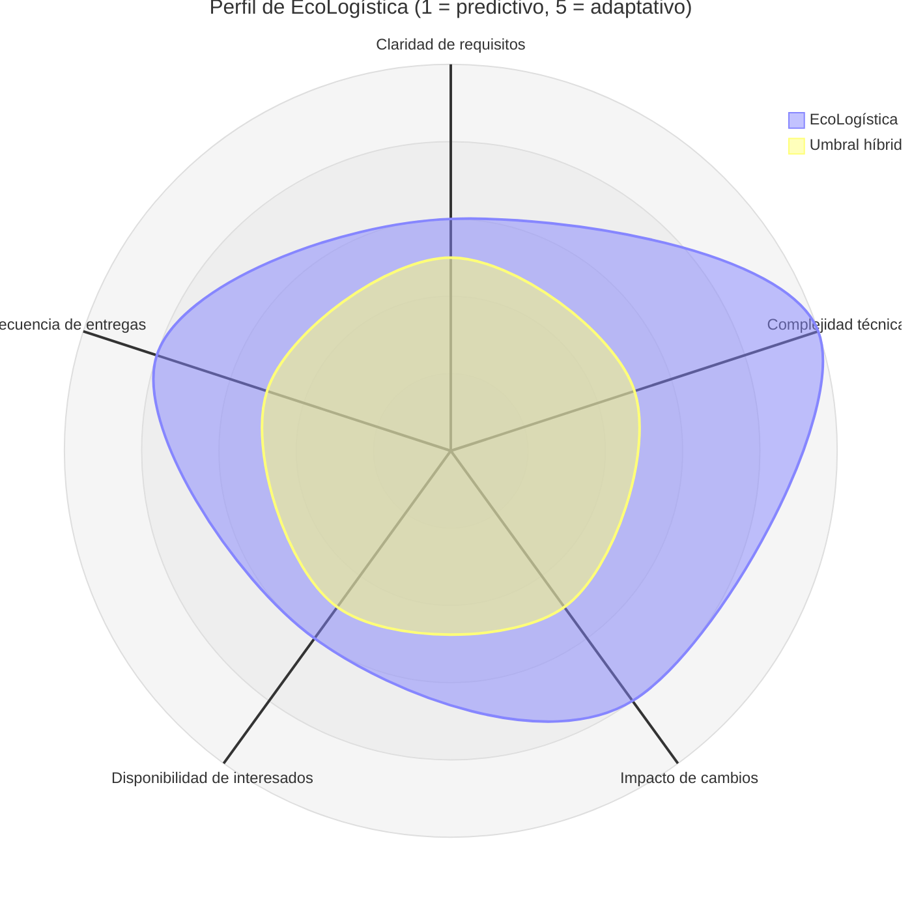

[← Volver al README Principal](../../README.md)

# Selección del Enfoque del Proyecto

| Metadato | Valor |
|---|---|
| Nombre del Proyecto | EcoLogística - Optimizador de rutas sostenibles de última milla para DistriRápido S.A.C. |
| Integrantes | Fernando Rodrigo Chaupis Espinoza (Director del proyecto, Product Owner, Scrum Master y Developer) |
| Docente | Daniel Gamarra Moreno |
| Fecha | 02/09/2026 |
| Versión | 1.0.0 |

---

## 1. Contexto para la decisión

El caso del curso, "EcoLogística Lima", describe a DistriRápido S.A.C., un operador logístico con más de 250 entregas
diarias, una flota de 15 camionetas mayormente diésel que emite cerca de 3,5 t de CO₂ al mes y un 22 % de entregas
fuera del horario acordado. El proyecto adapta ese caso a la operación de la empresa en **Huancayo Metropolitano
(Huancayo, El Tambo y Chilca)** y exige resolver un problema de ruteo de vehículos con ventanas de tiempo (VRPTW) con
criterios ambientales (Green VRP) mediante una metaheurística.

## 2. Matriz de Ponderación de Variables

Escala de cada variable: **1 = favorece un enfoque predictivo** y **5 = favorece un enfoque adaptativo (ágil)**.

| N° | Variable | Puntaje (1-5) | Peso | Puntaje ponderado | Justificación |
|:-:|---|:-:|:-:|:-:|---|
| V1 | Claridad y estabilidad de requisitos | 3 | 20 % | 0,60 | Los RF y RNF mínimos vienen del caso, pero deben adaptarse a Huancayo (horarios de bodegas y mercados, vías congestionadas, normas locales) y se precisan con cada revisión. |
| V2 | Complejidad técnica e innovación | 5 | 25 % | 1,25 | El VRPTW con criterio de emisiones es NP-difícil; la metaheurística (Búsqueda Tabú) se calibra por experimentación. |
| V3 | Severidad del impacto ante cambios | 4 | 20 % | 0,80 | Un cambio en restricciones (jornada, descansos, ventanas, incidentes) afecta al motor, a la base de datos y a varias pantallas. |
| V4 | Disponibilidad de los interesados | 3 | 15 % | 0,45 | El patrocinador es el caso del curso; la validación se concentra en las inspecciones del docente cada dos a tres semanas. |
| V5 | Frecuencia de entregas de valor | 4 | 20 % | 0,80 | El calendario exige incrementos verificables en cada inspección (Sprint 1 al Sprint 4). |
| | **Total** | | **100 %** | **3,90** | |

**Regla de interpretación:** 1,00 a 2,49 predictivo · 2,50 a 3,49 híbrido · 3,50 a 5,00 adaptativo.

## 3. Diagrama de Radar del Enfoque

Tabla descriptiva equivalente (por si el visor no renderiza el radar):

| Eje | Valor | Distancia al umbral ágil (3,5) | Lectura |
|---|:-:|:-:|---|
| Claridad de requisitos | 3 | −0,5 | Zona híbrida: requisitos base conocidos, detalle por descubrir |
| Complejidad técnica | 5 | +1,5 | Empuja con fuerza hacia lo adaptativo |
| Impacto de cambios | 4 | +0,5 | Conviene absorber cambios en iteraciones cortas |
| Disponibilidad de interesados | 3 | −0,5 | La retroalimentación llega por hitos, no diariamente |
| Frecuencia de entregas | 4 | +0,5 | Hay entregas obligatorias cada 2-3 semanas |

## 4. Análisis de sensibilidad

Se recalculó el puntaje variando cada variable en ±1 punto (manteniendo las demás) para comprobar que la decisión es
estable:

| Escenario | Puntaje resultante | Enfoque |
|---|:-:|---|
| Base | 3,90 | Adaptativo dentro de un marco híbrido |
| V1 = 2 (requisitos muy estables) | 3,70 | Adaptativo |
| V2 = 4 (menor complejidad) | 3,65 | Adaptativo |
| V4 = 2 (interesados poco disponibles) | 3,75 | Adaptativo |
| V5 = 3 (entregas menos frecuentes) | 3,70 | Adaptativo |
| Peor caso: V1 = 2, V2 = 4, V4 = 2, V5 = 3 | 3,10 | Híbrido |

Ningún cambio individual saca el resultado de la zona adaptativa y el peor caso combinado cae en híbrido. La decisión
es robusta: **construcción ágil** con un **marco predictivo** para hitos, presupuesto y documentos del curso.

## 5. Decisión y Justificación del Enfoque

**Enfoque seleccionado: Híbrido (marco predictivo para gobierno, hitos y cierre; ejecución ágil con Scrum en cuatro
sprints).**

Justificación alineada a PMBOK 7.ª edición:

1. **Dominio de desempeño "Enfoque de desarrollo y ciclo de vida":** PMBOK 7 recomienda elegir el enfoque por
   entregable. Los entregables de gestión (acta, presupuesto, cierre) tienen fechas fijas del curso y se gestionan de
   forma predictiva; el software, con alta incertidumbre técnica (V2 = 5), se construye de forma adaptativa.
2. **Principio "Adaptabilidad y resiliencia":** el motor VRPTW se valida temprano (Sprint 2) con pruebas de rendimiento
   (meta de 45 s para 150 pedidos y 15 vehículos); si no cumple, se corrige en el siguiente sprint sin rehacer el plan.
3. **Principio "Enfocarse en el valor":** cada sprint entrega un incremento usable (gestión base, rutas en mapa,
   re-optimización, indicadores y despliegue) que el docente revisa en la inspección correspondiente.
4. **Dominio "Equipo":** al ser un proyecto individual, una sola persona asume los roles de Product Owner, Scrum Master
   y Developer. La Daily Scrum se reemplaza por un registro diario de avance en Jira y en los commits; la revisión se
   realiza con el docente como interesado clave.
5. **Dominio "Medición":** se usan métricas de ambos mundos: valor ganado (EVM) para el marco predictivo y velocidad,
   burndown y burnup para los sprints.

---

## Historial de control de cambios

| Versión | Fecha | Autor | Descripción |
|---|---|---|---|
| 1.0.0 | 02/09/2026 | Fernando Rodrigo Chaupis Espinoza | Versión inicial: matriz de ponderación, radar Mermaid, análisis de sensibilidad y decisión del enfoque |

[← Volver al README Principal](../../README.md)
