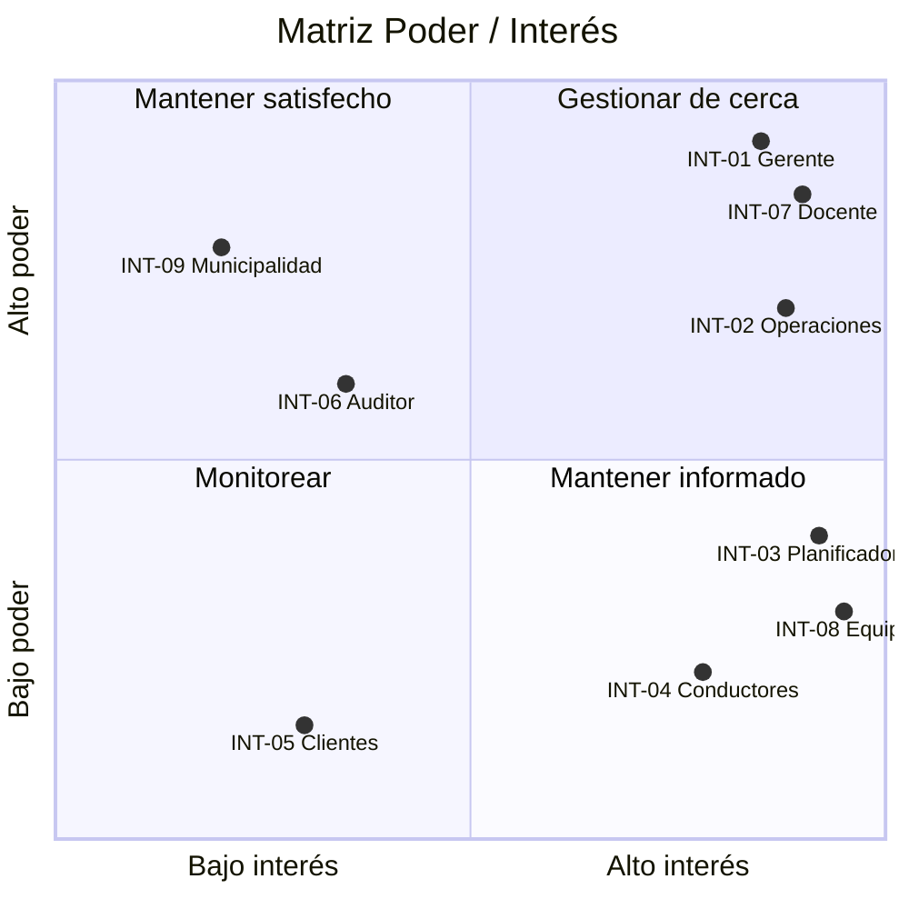

[← Volver al README Principal](../../README.md)

# Registro de Interesados (Stakeholders)

| Metadato | Valor |
|---|---|
| Nombre del Proyecto | EcoLogística - Optimizador de rutas sostenibles de última milla para DistriRápido S.A.C. |
| Integrantes | Fernando Rodrigo Chaupis Espinoza |
| Fecha | 02/09/2026 |
| Versión | 1.0.0 |

---

## 1. Matriz de Identificación de Interesados

| ID | Nombre / Rol | Organización / Área | Información de Contacto | Categoría |
|---|---|---|---|:-:|
| INT-01 | Gerente General (patrocinador) | DistriRápido S.A.C. - Gerencia | Reunión de revisión de cada sprint; correo corporativo del caso | Externo |
| INT-02 | Jefe de Operaciones Logísticas | DistriRápido S.A.C. - Operaciones | Revisión de cada sprint; usuario ADMIN del sistema | Externo |
| INT-03 | Planificadores de rutas | DistriRápido S.A.C. - Operaciones | Usuarios PLANIFICADOR del sistema; demostraciones | Externo |
| INT-04 | Conductores (15) | DistriRápido S.A.C. - Flota | Usuarios CONDUCTOR del sistema; encuesta de usabilidad | Externo |
| INT-05 | Clientes: bodegas, mercados, restaurantes y comercios | Huancayo, El Tambo y Chilca | Teléfono registrado en el módulo de clientes | Externo |
| INT-06 | Auditor ambiental / área de sostenibilidad | DistriRápido S.A.C. - Sostenibilidad | Usuario AUDITOR del sistema; reporte PDF mensual | Externo |
| INT-07 | Daniel Gamarra Moreno (docente evaluador) | Universidad Continental - Taller de Proyectos 2 | Aula virtual del curso; inspecciones programadas | Externo |
| INT-08 | Fernando Rodrigo Chaupis Espinoza (Director, PO, SM y Developer) | Equipo del proyecto | Repositorio GitHub y Jira del proyecto | Interno |
| INT-09 | Municipalidad Provincial de Huancayo - Gerencia de Tránsito | Gobierno local | Mesa de partes; solo bajo demanda | Externo |

## 2. Matriz Poder / Interés

| Cuadrante | Interesados | Justificación |
|---|---|---|
| Alto poder / Alto interés - **Gestionar de cerca** | INT-01, INT-02, INT-07 | Aprueban el alcance, aceptan los incrementos y califican el proyecto. |
| Alto poder / Bajo interés - **Mantener satisfecho** | INT-06, INT-09 | Pueden exigir reportes o imponer restricciones de tránsito y ambientales, pero no siguen el día a día. |
| Bajo poder / Alto interés - **Mantener informado** | INT-03, INT-04, INT-08 | Usan el sistema a diario; su opinión define la usabilidad (SUS). |
| Bajo poder / Bajo interés - **Monitorear** | INT-05 | Solo perciben el resultado: entregas dentro de su horario. |

## 3. Estrategia de Gestión y Comunicación

| Grupo | Objetivo de la comunicación | Información a entregar | Formato | Frecuencia | Responsable |
|---|---|---|---|---|---|
| Gestionar de cerca (INT-01, INT-02, INT-07) | Validar el incremento y aprobar cambios | Revisión del sprint, avance de hitos, EVM, riesgos | Demostración en vivo + documento Markdown en el repositorio | Al cierre de cada sprint (cada 2-3 semanas) | Director del proyecto |
| Mantener satisfecho (INT-06, INT-09) | Cumplir normas y demostrar impacto ambiental | Reporte PDF de sostenibilidad, plan de compensación | PDF generado por el sistema | Mensual o a solicitud | Director del proyecto |
| Mantener informado (INT-03, INT-04, INT-08) | Que sepan usar el sistema y den retroalimentación | Manual de usuario, novedades de cada versión, encuesta SUS | Manual en el repositorio, sesión de prueba guiada, encuesta en la aplicación | Por versión liberada | Director del proyecto |
| Monitorear (INT-05) | Respetar sus horarios y restricciones | Confirmación de horario preferido y punto de referencia | Registro en el módulo de clientes | Al registrar o actualizar el cliente | Planificador |

---

## Historial de control de cambios

| Versión | Fecha | Autor | Descripción |
|---|---|---|---|
| 1.0.0 | 02/09/2026 | Fernando Rodrigo Chaupis Espinoza | Versión inicial |

[← Volver al README Principal](../../README.md)
