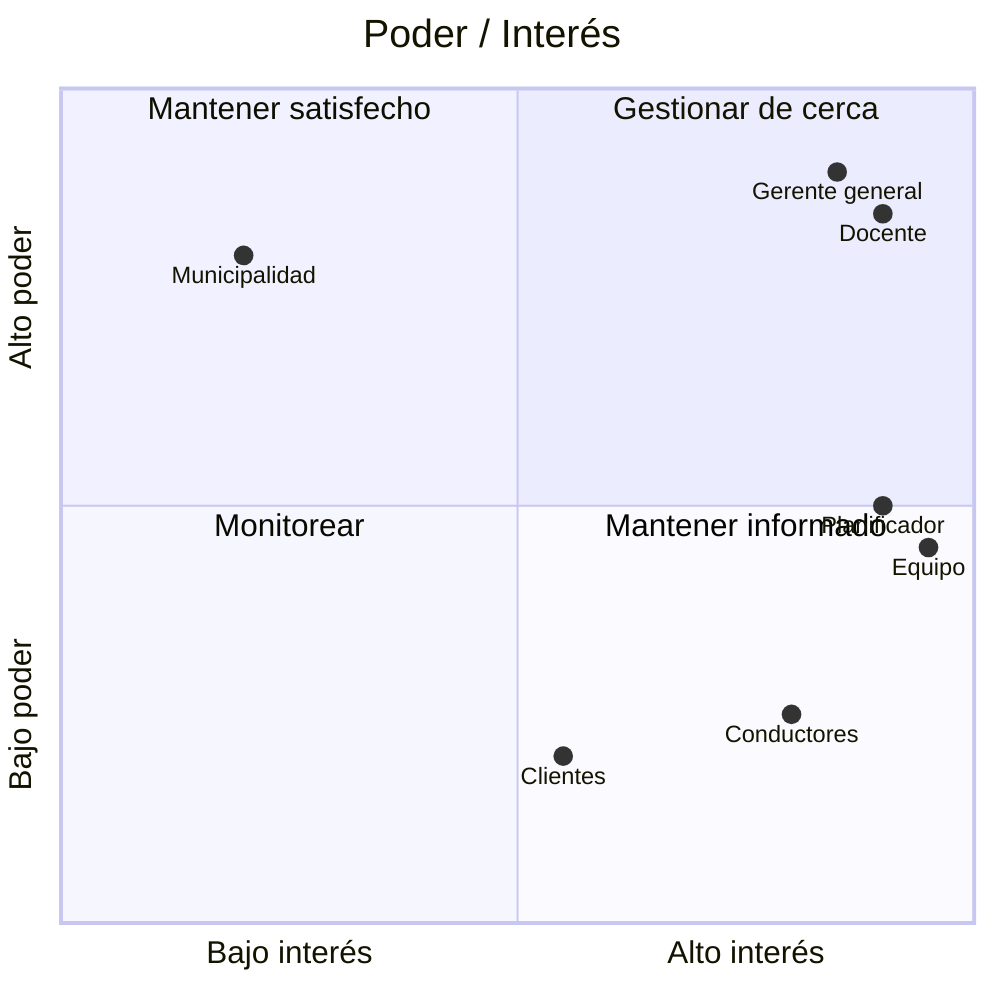

# Registro de Interesados (Stakeholders)

**Nombre del Proyecto:** EcoLogística - Optimizador de rutas sostenibles de última milla para DistriRápido S.A.C.

**Líder del Proyecto:** Fernando Rodrigo Chaupis Espinoza (Product Owner, Scrum Master y Developer; proyecto individual)

**Docente:** Daniel Gamarra Moreno

**Fecha:** 13/11/2026

**Versión:** 1.0.0

---

## 1. Matriz de Identificación de Interesados

| ID | Interesado | Rol / Cargo | Interés principal | Poder | Interés |
|---|---|---|---|:-:|:-:|
| I-01 | Gerente general de DistriRápido S.A.C. | Patrocinador | Reducir costos logísticos y emisiones | Alto | Alto |
| I-02 | Planificador de rutas | Usuario principal | Planificar rápido y sin errores | Medio | Alto |
| I-03 | Conductores | Usuario | Rutas claras y jornada respetada | Bajo | Alto |
| I-04 | Clientes (bodegas, restaurantes, farmacias) | Receptores | Recibir en su horario | Bajo | Medio |
| I-05 | Daniel Gamarra Moreno | Docente evaluador | Cumplimiento de los entregables | Alto | Alto |
| I-06 | Fernando Rodrigo Chaupis Espinoza | Equipo del proyecto | Entregar un producto de calidad | Medio | Alto |
| I-07 | Municipalidad Provincial de Huancayo | Autoridad de tránsito | Menos congestión en el centro | Alto | Bajo |

## 2. Matriz Poder / Interés

## 3. Estrategia de Gestión y Comunicación

| Cuadrante | Interesados | Estrategia | Medio y frecuencia |
|---|---|---|---|
| Gestionar de cerca | Gerente general, docente | Revisión de cada incremento y aprobación de cambios | Revisión del sprint, cada 2 semanas |
| Mantener informado | Planificador, conductores, equipo | Demostraciones y manual de usuario | Revisión del sprint y README |
| Mantener satisfecho | Municipalidad | Reporte de sostenibilidad cuando lo solicite | Bajo demanda |
| Monitorear | Clientes | Respetar sus preferencias de horario | Módulo de preferencias |

---

## Historial de control de cambios

| Versión | Fecha | Autor | Descripción |
|---|---|---|---|
| 1.0.0 | 13/11/2026 | Fernando Rodrigo Chaupis Espinoza | Versión inicial |
