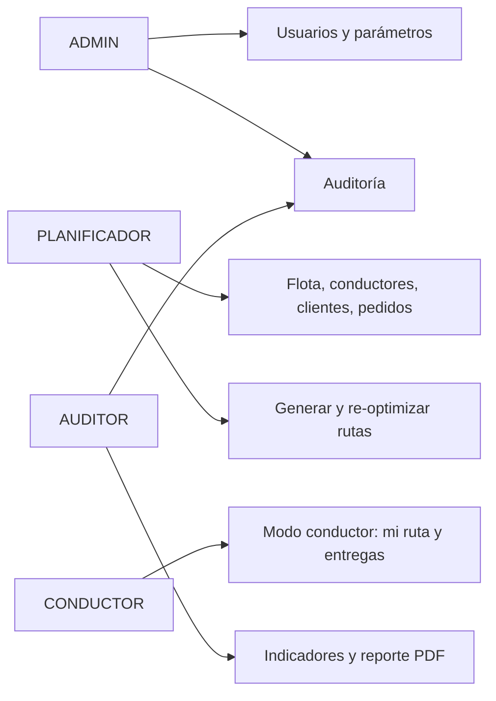

[← Volver al README Principal](../../README.md)

# Identificación y Perfiles de Usuarios

| Metadato | Valor |
|---|---|
| Nombre del Proyecto | EcoLogística - Optimizador de rutas sostenibles de última milla para DistriRápido S.A.C. |
| Integrantes | Fernando Rodrigo Chaupis Espinoza |
| Fecha | 19/11/2026 |
| Versión | 1.1.0 |

---
## 1. Matriz de Roles y Actores

| Actor | Tipo de interacción | Rol en el sistema | Descripción | Dispositivo habitual |
|---|---|---|---|---|
| Jefe de Operaciones / Administrador del sistema | Directa | **ADMIN** (Administrador) | Gestiona usuarios, parámetros del motor, zonas de riesgo y la bitácora; tiene todos los permisos operativos. | Escritorio |
| Planificador de rutas | Directa | **PLANIFICADOR** (Operador / Técnico) | Registra flota, conductores, clientes y pedidos; genera, revisa y re-optimiza rutas. | Escritorio |
| Conductor | Directa | **CONDUCTOR** (Usuario Final) | Consulta en "modo conductor" su ruta del día, el orden y la hora de cada entrega y las alertas; marca entregas realizadas. | Celular |
| Auditor ambiental o externo | Directa | **AUDITOR** (Auditor Externo) | Consulta indicadores, descarga reportes PDF y revisa y exporta la bitácora de auditoría sin modificar datos. | Escritorio |
| Gerencia General | Indirecta | - | Recibe el reporte PDF de sostenibilidad y aprueba decisiones. | - |
| Clientes (bodegas, mercados, restaurantes) | Indirecta | - | Reciben las entregas dentro de su horario; sus datos se registran en el módulo de clientes. | - |
| Servicio de mosaicos OpenStreetMap | Sistema externo | - | Provee el mapa base. | - |

## 2. Historias de Uso Resumidas

| Rol | Interacciones principales |
|---|---|
| ADMIN | Inicia sesión → crea o desactiva usuarios → ajusta velocidad, factor vial y peso del CO₂ → registra zonas de riesgo → revisa la auditoría → elimina físicamente datos de prueba. |
| PLANIFICADOR | Inicia sesión → registra o actualiza clientes, pedidos, vehículos y conductores → pulsa "Generar rutas optimizadas" → revisa el mapa → registra incidentes y re-optimiza → descarga el reporte PDF. |
| CONDUCTOR | Inicia sesión en el celular → ve su ruta del día con la siguiente entrega resaltada → revisa alertas de tráfico o incidentes → marca la entrega como realizada. |
| AUDITOR | Inicia sesión → revisa el Dashboard y la pantalla Sostenibilidad → descarga el reporte PDF → filtra y exporta la bitácora de auditoría. |

## 3. Matriz de Control de Acceso (RBAC)

Notación: **C** crear, **R** leer, **U** actualizar, **D** eliminar (lógico salvo indicación), **CRUD** todos.

| Módulo / Capacidad | Rol: Administrador (ADMIN) | Rol: Operador / Técnico (PLANIFICADOR) | Rol: Usuario Final (CONDUCTOR) | Rol: Auditor Externo (AUDITOR) |
|---|:-:|:-:|:-:|:-:|
| Configuración de Parámetros del motor | CRUD | Lectura | Sin Acceso | Lectura |
| Gestión de usuarios y roles | CRUD | Sin Acceso | Sin Acceso | Lectura |
| Flota y conductores | CRUD | CRUD | Lectura (solo su vehículo) | Lectura |
| Clientes y pedidos (datos transaccionales) | CRUD | CRUD | Lectura (solo sus entregas) | Lectura |
| Rutas: generar y re-optimizar | CRUD | CRUD | Sin Acceso | Lectura |
| Rutas: marcar entrega realizada | U | U | U (solo su ruta) | Sin Acceso |
| Indicadores y reporte PDF | Lectura | Lectura | Lectura (solo sus indicadores) | Lectura |
| Plan y registro de compensación | CRUD | Crear / Lectura | Sin Acceso | Lectura |
| Depuración / Eliminación Física | D | Sin Acceso | Sin Acceso | Sin Acceso |
| Exportación de Logs de Auditoría | Lectura | Sin Acceso | Sin Acceso | Lectura (Solo Lectura) |

Reglas de aplicación:

- El rol viaja firmado dentro del token JWT y cada endpoint valida el rol en el servidor; el menú del frontend solo oculta
  opciones, no es la medida de seguridad.
- Un usuario ADMIN no puede desactivarse ni quitarse el rol a sí mismo.
- El CONDUCTOR solo accede a los datos vinculados a su usuario (control basado en atributos: `conductor.usuario_id`).

---

## Historial de control de cambios

| Versión | Fecha | Autor | Descripción |
|---|---|---|---|
| 1.0.0 | 11/09/2026 | Fernando Rodrigo Chaupis Espinoza | Versión inicial con 4 roles y matriz RBAC |
| 1.1.0 | 19/11/2026 | Fernando Rodrigo Chaupis Espinoza | Cambio de alcance del Sprint 4 (enunciado oficial del caso): roles, historias de uso y permisos RBAC revisados |

[← Volver al README Principal](../../README.md)
