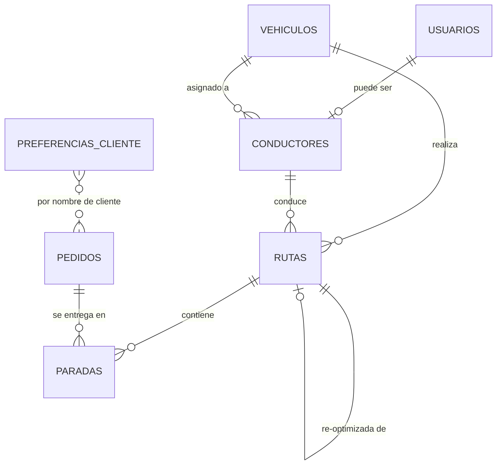

# Base de datos

| Campo | Valor |
|---|---|
| Proyecto | EcoLogística - Optimizador de rutas sostenibles de última milla |
| Organización | DistriRápido S.A.C., Huancayo, Junín |
| Curso | Taller de Proyectos 2, Universidad Continental |
| Versión | 1.0.0 |
| Fecha | 13/11/2026 |
| Elaborado por | Fernando Rodrigo Chaupis Espinoza |
| Revisado por | Docente: Daniel Gamarra Moreno |

---

## Modelo entidad-relación

## Tablas

| Tabla | Campos principales |
|---|---|
| usuarios | id, correo (único), nombre, password_hash, rol, activo |
| vehiculos | id, placa (única), tipo, capacidad_kg, combustible, consumo_100km, activo |
| conductores | id, nombre, dni (único), licencia, telefono, hora_inicio, jornada_max_min, vehiculo_id, usuario_id, activo |
| pedidos | id, codigo (único), cliente, direccion, distrito, lat, lng, peso_kg, ventana_inicio, ventana_fin, prioridad, estado |
| preferencias_cliente | id, cliente (único), hora_desde, hora_hasta, dias, notas |
| rutas | id, fecha, vehiculo_id, conductor_id, hora_inicio, hora_fin, distancia_km, duracion_min, co2_kg, distancia_base_km, co2_base_kg, estado, ruta_origen_id |
| paradas | id, ruta_id, pedido_id, orden, hora_llegada, estado |
| compensaciones | id, fecha, accion, proveedor, co2_kg, costo_soles |

Definición en código: `backend/app/models.py`.
