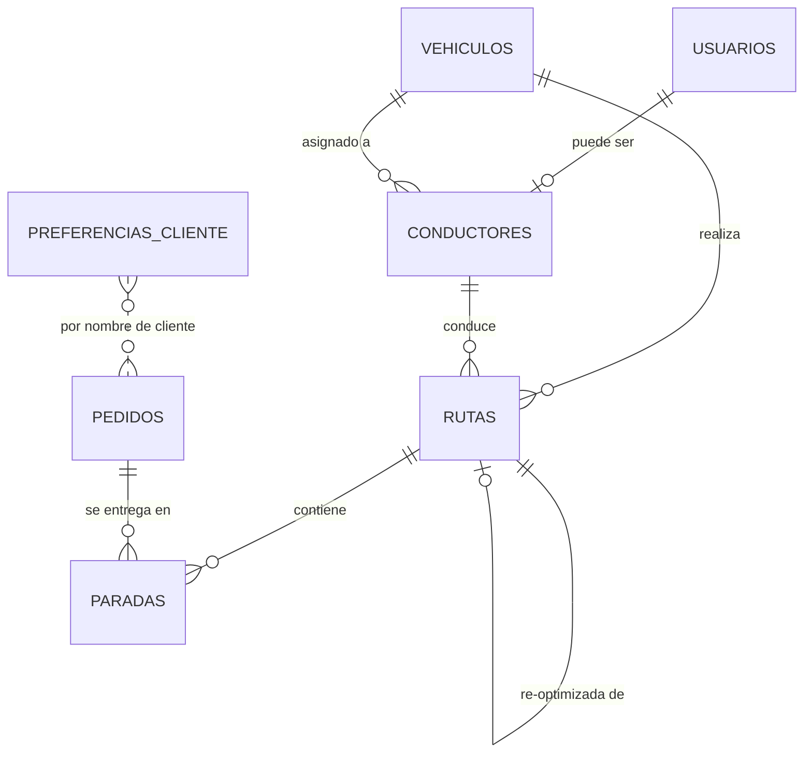

# Diseño e Ingeniería de Base de Datos

**Nombre del Proyecto:** EcoLogística - Optimizador de rutas sostenibles de última milla para DistriRápido S.A.C.

**Líder del Proyecto:** Fernando Rodrigo Chaupis Espinoza (Product Owner, Scrum Master y Developer; proyecto individual)

**Docente:** Daniel Gamarra Moreno

**Fecha:** 13/11/2026

**Versión:** 1.0.0

---

## 1. Modelo Conceptual (Diagrama Entidad-Relación)



## 2. Modelo Lógico

| Tabla | Clave | Atributos | Relaciones |
|---|---|---|---|
| usuarios | id | correo (único), nombre, password_hash, rol, activo | 1 a 0..1 con conductores |
| vehiculos | id | placa (única), tipo, capacidad_kg, combustible, consumo_100km, activo | 1 a N con conductores y rutas |
| conductores | id | nombre, dni (único), licencia, telefono, hora_inicio, jornada_max_min, activo | N a 1 con vehiculos; 0..1 a 1 con usuarios |
| pedidos | id | codigo (único), cliente, direccion, distrito, lat, lng, peso_kg, ventana_inicio, ventana_fin, prioridad, estado | 1 a N con paradas |
| preferencias_cliente | id | cliente (único), hora_desde, hora_hasta, dias, notas | Por nombre de cliente |
| rutas | id | fecha, hora_inicio, hora_fin, distancia_km, duracion_min, co2_kg, distancia_base_km, co2_base_kg, estado | N a 1 con vehiculos y conductores; 1 a N con paradas; 0..1 a 1 con rutas (origen) |
| paradas | id | orden, hora_llegada, estado | N a 1 con rutas y pedidos |
| compensaciones | id | fecha, accion, proveedor, co2_kg, costo_soles | - |

## 3. Modelo Físico (DDL SQL) e Índices

```sql
CREATE TABLE vehiculos (
  id SERIAL PRIMARY KEY,
  placa VARCHAR(10) NOT NULL UNIQUE,
  tipo VARCHAR(40) NOT NULL,
  capacidad_kg DOUBLE PRECISION NOT NULL,
  combustible VARCHAR(12) NOT NULL,
  consumo_100km DOUBLE PRECISION NOT NULL,
  activo BOOLEAN NOT NULL DEFAULT TRUE
);

CREATE TABLE pedidos (
  id SERIAL PRIMARY KEY,
  codigo VARCHAR(20) NOT NULL UNIQUE,
  cliente VARCHAR(120) NOT NULL,
  direccion VARCHAR(200) NOT NULL,
  distrito VARCHAR(60),
  lat DOUBLE PRECISION NOT NULL,
  lng DOUBLE PRECISION NOT NULL,
  peso_kg DOUBLE PRECISION NOT NULL,
  ventana_inicio VARCHAR(5) NOT NULL,
  ventana_fin VARCHAR(5) NOT NULL,
  prioridad INTEGER NOT NULL DEFAULT 2,
  estado VARCHAR(12) NOT NULL DEFAULT 'PENDIENTE',
  creado_en TIMESTAMP DEFAULT now()
);

CREATE TABLE rutas (
  id SERIAL PRIMARY KEY,
  fecha DATE NOT NULL,
  vehiculo_id INTEGER NOT NULL REFERENCES vehiculos(id),
  conductor_id INTEGER REFERENCES conductores(id),
  hora_inicio VARCHAR(5) NOT NULL,
  hora_fin VARCHAR(5) NOT NULL,
  distancia_km DOUBLE PRECISION NOT NULL,
  duracion_min INTEGER NOT NULL,
  co2_kg DOUBLE PRECISION NOT NULL,
  distancia_base_km DOUBLE PRECISION NOT NULL,
  co2_base_kg DOUBLE PRECISION NOT NULL,
  estado VARCHAR(12) NOT NULL DEFAULT 'PLANIFICADA',
  ruta_origen_id INTEGER REFERENCES rutas(id)
);

CREATE TABLE paradas (
  id SERIAL PRIMARY KEY,
  ruta_id INTEGER NOT NULL REFERENCES rutas(id),
  pedido_id INTEGER NOT NULL REFERENCES pedidos(id),
  orden INTEGER NOT NULL,
  hora_llegada VARCHAR(5) NOT NULL,
  estado VARCHAR(12) NOT NULL DEFAULT 'PENDIENTE'
);

-- Índices (PostgreSQL no indexa las llaves foráneas por defecto)
CREATE INDEX ix_pedidos_estado ON pedidos (estado);
CREATE INDEX ix_pedidos_cliente ON pedidos (cliente);
CREATE INDEX ix_rutas_fecha ON rutas (fecha);
CREATE INDEX ix_rutas_estado ON rutas (estado);
CREATE INDEX ix_rutas_vehiculo_id ON rutas (vehiculo_id);
CREATE INDEX ix_rutas_conductor_id ON rutas (conductor_id);
CREATE INDEX ix_paradas_ruta_id ON paradas (ruta_id);
CREATE INDEX ix_paradas_pedido_id ON paradas (pedido_id);
```

Las tablas `usuarios`, `conductores`, `preferencias_cliente` y `compensaciones` siguen el mismo patrón. La definición
completa está en `backend/app/models.py` (SQLAlchemy crea las tablas al iniciar la API).

---

## Historial de control de cambios

| Versión | Fecha | Autor | Descripción |
|---|---|---|---|
| 1.0.0 | 13/11/2026 | Fernando Rodrigo Chaupis Espinoza | Versión inicial |
