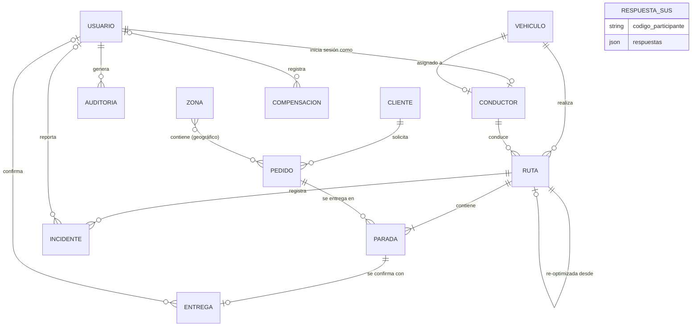

[← Volver al README Principal](../../README.md)

# Diseño e Ingeniería de Base de Datos

| Metadato | Valor |
|---|---|
| Nombre del Proyecto | EcoLogística - Optimizador de rutas sostenibles de última milla para DistriRápido S.A.C. |
| Integrantes | Fernando Rodrigo Chaupis Espinoza |
| Motor | PostgreSQL 16 |
| Fecha | 20/11/2026 |
| Versión | 1.3.0 |

---
## 1. Modelo Conceptual (Diagrama Entidad-Relación)



`RESPUESTA_SUS` no se relaciona con `USUARIO`: los participantes usan una cuenta de evaluador compartida y se
identifican solo con un código (P1, P2…), sin datos personales (Ley N.º 29733).

| Entidad | Descripción |
|---|---|
| USUARIO | Persona que accede al sistema con un rol (ADMIN, PLANIFICADOR, CONDUCTOR, AUDITOR). |
| VEHICULO | Unidad de la flota con capacidad, combustible, rendimiento, emisiones y datos de costo. |
| CONDUCTOR | Persona habilitada para conducir, con licencia, disponibilidad, jornada y punto de partida. |
| CLIENTE | Bodega, mercado o comercio con horario preferido y restricciones de acceso. |
| PEDIDO | Entrega solicitada por un cliente con peso, volumen, ventana, prioridad y tipo de producto. |
| RUTA | Recorrido planificado de un vehículo en una fecha, con distancia, CO₂ y su línea base. |
| PARADA | Visita ordenada de una ruta a un pedido, con hora estimada, tramo y congestión. |
| ENTREGA | Confirmación de una parada por el conductor: hora real de la entrega y foto opcional. |
| INCIDENTE | Evento que obliga a re-optimizar una ruta (tráfico, accidente, avería, pedido nuevo, etc.). |
| ZONA | Polígono geográfico: restringida (Centro), de riesgo o sensible. |
| COMPENSACION | Acción registrada para compensar CO₂ (árboles o bonos). |
| CONFIGURACION | Parámetros vigentes del motor (fila única). |
| AUDITORIA | Bitácora de cada operación de escritura y de cada intento de acceso. |
| RESPUESTA_SUS | Respuestas del cuestionario de usabilidad SUS. |

## 2. Modelo Lógico (3FN)

| Tabla | Atributos (PK subrayada con **negrita**, FK en *cursiva*) |
|---|---|
| usuarios | **usuario_id**, correo (UNIQUE), nombre, password_hash, rol, activo, intentos_fallidos, bloqueado_hasta, creado_en |
| vehiculos | **vehiculo_id**, placa (UNIQUE), tipo, capacidad_kg, volumen_m3, combustible, rendimiento, factor_emision_kg_km, anio_fabricacion, valor_adquisicion_soles, seguro_anual_soles, activo, creado_en |
| conductores | **conductor_id**, nombre, dni (UNIQUE), licencia, categoria_licencia, anios_experiencia, telefono, disponible_desde, disponible_hasta, jornada_max_min, partida_lat, partida_lng, *vehiculo_id*, *usuario_id*, activo |
| clientes | **cliente_id**, nombre, telefono, direccion, distrito, punto_referencia, restricciones_acceso, hora_desde, hora_hasta, dias_atencion, lat, lng, activo |
| pedidos | **pedido_id**, codigo (UNIQUE), *cliente_id*, direccion, punto_referencia, lat, lng, peso_kg, volumen_m3, ventana_inicio, ventana_fin, prioridad, tipo_producto, estado, creado_en |
| rutas | **ruta_id**, fecha, *vehiculo_id*, *conductor_id*, *ruta_origen_id*, hora_inicio, hora_fin, distancia_km, duracion_min, co2_kg, descanso_min, distancia_base_km, co2_base_kg, partida_lat, partida_lng, estado, creada_en |
| paradas | **parada_id**, *ruta_id*, *pedido_id*, orden, hora_llegada, distancia_tramo_km, tiempo_tramo_min, congestion, fuera_ventana, estado |
| entregas | **entrega_id**, *parada_id* (UNIQUE), *usuario_id*, entregada_en, foto_tipo, foto (BYTEA) |
| incidentes | **incidente_id**, *ruta_id*, *ruta_nueva_id*, tipo, hora, demora_min, *pedido_id*, descripcion, *usuario_id*, creado_en |
| zonas | **zona_id**, nombre, tipo, poligono (JSONB), activa |
| compensaciones | **compensacion_id**, fecha, accion, proveedor, co2_kg, costo_soles, *usuario_id* |
| configuracion | **configuracion_id** (= 1), velocidad_kmh, velocidad_punta_kmh, factor_vial, peso_co2, servicio_min, limite_segundos, precio_diesel_galon, costo_mantenimiento_km, digitos_placa_restringidos, actualizado_en |
| auditoria | **auditoria_id**, fecha, *usuario_id*, correo, accion, recurso, estado_http |
| respuestas_sus | **respuesta_id**, codigo_participante (UNIQUE), perfil, respuestas (JSONB, 10 valores de 1 a 5), tareas_completadas, comentario, creado_en |

**Verificación de normalización:**

- **1FN:** todos los atributos son atómicos; los días de atención se guardan como texto normalizado ("LU,MA,MI") de
  dominio cerrado, los polígonos en JSONB como un único valor geográfico y las 10 respuestas SUS en JSONB como un
  único cuestionario (siempre se leen y validan juntas; el puntaje se calcula al consultar y no se almacena).
- **2FN:** todas las tablas tienen clave primaria simple, por lo que no existen dependencias parciales.
- **3FN:** no hay dependencias transitivas: los datos del cliente viven en `clientes` y el pedido solo guarda su
  `cliente_id` (la dirección del pedido es la de entrega, que puede diferir); el vehículo de una ruta se obtiene por FK y
  no se copian sus atributos. Los campos `distancia_base_km` y `co2_base_kg` son resultados históricos del cálculo en
  ese momento, no derivados de otras columnas actuales.

## 3. Modelo Físico (DDL SQL) e Índices

Decisión de claves: identificadores `BIGINT GENERATED ALWAYS AS IDENTITY` (8 bytes frente a 16 de un UUID) para mantener
índices compactos; el identificador expuesto al usuario es el `codigo` del pedido o la placa del vehículo.

```sql
CREATE TABLE usuarios (
    usuario_id        BIGINT GENERATED ALWAYS AS IDENTITY PRIMARY KEY,
    correo            VARCHAR(255) NOT NULL UNIQUE,
    nombre            VARCHAR(120) NOT NULL,
    password_hash     VARCHAR(255) NOT NULL,
    rol               VARCHAR(15)  NOT NULL CHECK (rol IN ('ADMIN','PLANIFICADOR','CONDUCTOR','AUDITOR')),
    activo            BOOLEAN      NOT NULL DEFAULT TRUE,
    intentos_fallidos SMALLINT     NOT NULL DEFAULT 0,
    bloqueado_hasta   TIMESTAMP WITH TIME ZONE,
    creado_en         TIMESTAMP WITH TIME ZONE NOT NULL DEFAULT CURRENT_TIMESTAMP
);

CREATE TABLE vehiculos (
    vehiculo_id             BIGINT GENERATED ALWAYS AS IDENTITY PRIMARY KEY,
    placa                   VARCHAR(10)  NOT NULL UNIQUE,
    tipo                    VARCHAR(12)  NOT NULL CHECK (tipo IN ('CAMIONETA','FURGON','MOTO')),
    capacidad_kg            NUMERIC(8,2) NOT NULL CHECK (capacidad_kg > 0),
    volumen_m3              NUMERIC(6,2) NOT NULL CHECK (volumen_m3 > 0),
    combustible             VARCHAR(10)  NOT NULL CHECK (combustible IN ('DIESEL','GASOLINA','GLP','GNV','ELECTRICO')),
    rendimiento             NUMERIC(6,2) NOT NULL CHECK (rendimiento > 0),  -- km/L, km/m3 o km/kWh
    factor_emision_kg_km    NUMERIC(6,4) NOT NULL CHECK (factor_emision_kg_km >= 0),
    anio_fabricacion        SMALLINT     NOT NULL CHECK (anio_fabricacion BETWEEN 1980 AND 2100),
    valor_adquisicion_soles NUMERIC(12,2) NOT NULL DEFAULT 0,
    seguro_anual_soles      NUMERIC(10,2) NOT NULL DEFAULT 0,
    activo                  BOOLEAN      NOT NULL DEFAULT TRUE,
    creado_en               TIMESTAMP WITH TIME ZONE NOT NULL DEFAULT CURRENT_TIMESTAMP
);

CREATE TABLE conductores (
    conductor_id       BIGINT GENERATED ALWAYS AS IDENTITY PRIMARY KEY,
    nombre             VARCHAR(120) NOT NULL,
    dni                CHAR(8)      NOT NULL UNIQUE,
    licencia           VARCHAR(15)  NOT NULL,
    categoria_licencia VARCHAR(6)   NOT NULL,
    anios_experiencia  SMALLINT     NOT NULL DEFAULT 0 CHECK (anios_experiencia >= 0),
    telefono           VARCHAR(15),
    disponible_desde   TIME         NOT NULL DEFAULT '07:00',
    disponible_hasta   TIME         NOT NULL DEFAULT '17:00',
    jornada_max_min    SMALLINT     NOT NULL DEFAULT 480 CHECK (jornada_max_min BETWEEN 60 AND 600),
    partida_lat        NUMERIC(9,6),
    partida_lng        NUMERIC(9,6),
    vehiculo_id        BIGINT REFERENCES vehiculos(vehiculo_id) ON DELETE SET NULL,
    usuario_id         BIGINT UNIQUE REFERENCES usuarios(usuario_id) ON DELETE SET NULL,
    activo             BOOLEAN      NOT NULL DEFAULT TRUE
);

CREATE TABLE clientes (
    cliente_id           BIGINT GENERATED ALWAYS AS IDENTITY PRIMARY KEY,
    nombre               VARCHAR(150) NOT NULL,
    telefono             VARCHAR(15),
    direccion            VARCHAR(200) NOT NULL,
    distrito             VARCHAR(40)  NOT NULL,
    punto_referencia     VARCHAR(200),
    restricciones_acceso VARCHAR(200),
    hora_desde           TIME         NOT NULL DEFAULT '06:00',
    hora_hasta           TIME         NOT NULL DEFAULT '21:00',
    dias_atencion        VARCHAR(30)  NOT NULL DEFAULT 'LU,MA,MI,JU,VI,SA',
    lat                  NUMERIC(9,6) NOT NULL,
    lng                  NUMERIC(9,6) NOT NULL,
    activo               BOOLEAN      NOT NULL DEFAULT TRUE,
    CHECK (hora_hasta > hora_desde)
);

CREATE TABLE pedidos (
    pedido_id        BIGINT GENERATED ALWAYS AS IDENTITY PRIMARY KEY,
    codigo           VARCHAR(20)  NOT NULL UNIQUE,
    cliente_id       BIGINT       NOT NULL REFERENCES clientes(cliente_id),
    direccion        VARCHAR(200) NOT NULL,
    punto_referencia VARCHAR(200),
    lat              NUMERIC(9,6) NOT NULL,
    lng              NUMERIC(9,6) NOT NULL,
    peso_kg          NUMERIC(8,2) NOT NULL CHECK (peso_kg > 0),
    volumen_m3       NUMERIC(6,3) NOT NULL DEFAULT 0 CHECK (volumen_m3 >= 0),
    ventana_inicio   TIME         NOT NULL,
    ventana_fin      TIME         NOT NULL,
    prioridad        VARCHAR(10)  NOT NULL DEFAULT 'ESTANDAR' CHECK (prioridad IN ('EXPRESS','ESTANDAR','ECONOMICO')),
    tipo_producto    VARCHAR(15)  NOT NULL DEFAULT 'NO_PERECEDERO' CHECK (tipo_producto IN ('PERECEDERO','NO_PERECEDERO')),
    estado           VARCHAR(12)  NOT NULL DEFAULT 'PENDIENTE'
                     CHECK (estado IN ('PENDIENTE','PLANIFICADO','ENTREGADO','CANCELADO')),
    creado_en        TIMESTAMP WITH TIME ZONE NOT NULL DEFAULT CURRENT_TIMESTAMP,
    CHECK (ventana_fin > ventana_inicio)
);

CREATE TABLE rutas (
    ruta_id           BIGINT GENERATED ALWAYS AS IDENTITY PRIMARY KEY,
    fecha             DATE         NOT NULL DEFAULT CURRENT_DATE,
    vehiculo_id       BIGINT       NOT NULL REFERENCES vehiculos(vehiculo_id),
    conductor_id      BIGINT       REFERENCES conductores(conductor_id),
    ruta_origen_id    BIGINT       REFERENCES rutas(ruta_id),
    hora_inicio       TIME         NOT NULL,
    hora_fin          TIME         NOT NULL,
    distancia_km      NUMERIC(8,2) NOT NULL DEFAULT 0,
    duracion_min      INTEGER      NOT NULL DEFAULT 0,
    co2_kg            NUMERIC(8,3) NOT NULL DEFAULT 0,
    descanso_min      SMALLINT     NOT NULL DEFAULT 0 CHECK (descanso_min >= 0),
    distancia_base_km NUMERIC(8,2) NOT NULL DEFAULT 0,
    co2_base_kg       NUMERIC(8,3) NOT NULL DEFAULT 0,
    partida_lat       NUMERIC(9,6),
    partida_lng       NUMERIC(9,6),
    estado            VARCHAR(12)  NOT NULL DEFAULT 'PLANIFICADA'
                      CHECK (estado IN ('PLANIFICADA','EN_CURSO','COMPLETADA','REOPTIMIZADA')),
    creada_en         TIMESTAMP WITH TIME ZONE NOT NULL DEFAULT CURRENT_TIMESTAMP
);

CREATE TABLE paradas (
    parada_id          BIGINT GENERATED ALWAYS AS IDENTITY PRIMARY KEY,
    ruta_id            BIGINT       NOT NULL REFERENCES rutas(ruta_id) ON DELETE CASCADE,
    pedido_id          BIGINT       NOT NULL REFERENCES pedidos(pedido_id),
    orden              SMALLINT     NOT NULL CHECK (orden > 0),
    hora_llegada       TIME         NOT NULL,
    distancia_tramo_km NUMERIC(7,2) NOT NULL DEFAULT 0,
    tiempo_tramo_min   SMALLINT     NOT NULL DEFAULT 0,
    congestion         VARCHAR(8)   NOT NULL DEFAULT 'VERDE' CHECK (congestion IN ('VERDE','AMARILLO','ROJO')),
    fuera_ventana      BOOLEAN      NOT NULL DEFAULT FALSE,
    estado             VARCHAR(12)  NOT NULL DEFAULT 'PENDIENTE' CHECK (estado IN ('PENDIENTE','ENTREGADA','OMITIDA')),
    UNIQUE (ruta_id, orden)
);

-- Confirmación de la entrega (US-014). Tabla aparte de paradas: la foto solo se lee al pedirla y no viaja en el
-- listado de rutas.
CREATE TABLE entregas (
    entrega_id   BIGINT GENERATED ALWAYS AS IDENTITY PRIMARY KEY,
    parada_id    BIGINT      NOT NULL UNIQUE REFERENCES paradas(parada_id) ON DELETE CASCADE,
    usuario_id   BIGINT      REFERENCES usuarios(usuario_id) ON DELETE SET NULL,
    entregada_en TIMESTAMP WITH TIME ZONE NOT NULL DEFAULT CURRENT_TIMESTAMP,
    foto_tipo    VARCHAR(20) CHECK (foto_tipo IN ('image/jpeg','image/png','image/webp')),
    foto         BYTEA       CHECK (foto IS NULL OR octet_length(foto) <= 409600),
    CHECK ((foto IS NULL) = (foto_tipo IS NULL))
);

CREATE TABLE incidentes (
    incidente_id  BIGINT GENERATED ALWAYS AS IDENTITY PRIMARY KEY,
    ruta_id       BIGINT      NOT NULL REFERENCES rutas(ruta_id),
    ruta_nueva_id BIGINT      REFERENCES rutas(ruta_id),
    tipo          VARCHAR(16) NOT NULL CHECK (tipo IN ('TRAFICO','ACCIDENTE','BLOQUEO_VIA','CLIMA',
                                                       'AVERIA_VEHICULO','PEDIDO_NUEVO','CANCELACION')),
    hora          TIME        NOT NULL,
    demora_min    SMALLINT    NOT NULL DEFAULT 0,
    pedido_id     BIGINT      REFERENCES pedidos(pedido_id),
    descripcion   VARCHAR(250),
    usuario_id    BIGINT      REFERENCES usuarios(usuario_id),
    creado_en     TIMESTAMP WITH TIME ZONE NOT NULL DEFAULT CURRENT_TIMESTAMP
);

CREATE TABLE zonas (
    zona_id  BIGINT GENERATED ALWAYS AS IDENTITY PRIMARY KEY,
    nombre   VARCHAR(100) NOT NULL,
    tipo     VARCHAR(12)  NOT NULL CHECK (tipo IN ('RESTRINGIDA','RIESGO','SENSIBLE','DISTRITO')),
    poligono JSONB        NOT NULL,
    activa   BOOLEAN      NOT NULL DEFAULT TRUE
);

CREATE TABLE compensaciones (
    compensacion_id BIGINT GENERATED ALWAYS AS IDENTITY PRIMARY KEY,
    fecha           DATE          NOT NULL DEFAULT CURRENT_DATE,
    accion          VARCHAR(20)   NOT NULL CHECK (accion IN ('REFORESTACION','BONO_CARBONO')),
    proveedor       VARCHAR(150),
    co2_kg          NUMERIC(10,2) NOT NULL CHECK (co2_kg > 0),
    costo_soles     NUMERIC(10,2) NOT NULL DEFAULT 0,
    usuario_id      BIGINT        REFERENCES usuarios(usuario_id)
);

CREATE TABLE configuracion (
    configuracion_id          SMALLINT     PRIMARY KEY DEFAULT 1 CHECK (configuracion_id = 1),
    velocidad_kmh             NUMERIC(5,2) NOT NULL DEFAULT 25,
    velocidad_punta_kmh       NUMERIC(5,2) NOT NULL DEFAULT 15,
    factor_vial               NUMERIC(4,2) NOT NULL DEFAULT 1.3,
    peso_co2                  NUMERIC(4,2) NOT NULL DEFAULT 1.0,
    servicio_min              SMALLINT     NOT NULL DEFAULT 10,
    limite_segundos           SMALLINT     NOT NULL DEFAULT 30,
    precio_diesel_galon       NUMERIC(6,2) NOT NULL DEFAULT 17.50,
    costo_mantenimiento_km    NUMERIC(6,2) NOT NULL DEFAULT 1.20,
    digitos_placa_restringidos VARCHAR(40) NOT NULL DEFAULT '',
    actualizado_en            TIMESTAMP WITH TIME ZONE NOT NULL DEFAULT CURRENT_TIMESTAMP
);

CREATE TABLE auditoria (
    auditoria_id BIGINT GENERATED ALWAYS AS IDENTITY PRIMARY KEY,
    fecha        TIMESTAMP WITH TIME ZONE NOT NULL DEFAULT CURRENT_TIMESTAMP,
    usuario_id   BIGINT REFERENCES usuarios(usuario_id) ON DELETE SET NULL,
    correo       VARCHAR(255),
    accion       VARCHAR(10)  NOT NULL,
    recurso      VARCHAR(200) NOT NULL,
    estado_http  SMALLINT     NOT NULL
);

CREATE TABLE respuestas_sus (
    respuesta_id        BIGINT GENERATED ALWAYS AS IDENTITY PRIMARY KEY,
    codigo_participante VARCHAR(10) NOT NULL UNIQUE,
    perfil              VARCHAR(60) NOT NULL,
    -- Las 10 respuestas en orden; la API valida que cada una sea un entero de 1 a 5
    respuestas          JSONB       NOT NULL CHECK (jsonb_typeof(respuestas) = 'array'
                                                    AND jsonb_array_length(respuestas) = 10),
    tareas_completadas  SMALLINT    NOT NULL DEFAULT 0,
    comentario          VARCHAR(500),
    creado_en           TIMESTAMP WITH TIME ZONE NOT NULL DEFAULT CURRENT_TIMESTAMP
);

-- Índices de búsqueda y de llaves foráneas
CREATE INDEX idx_usuarios_correo      ON usuarios(correo);
CREATE INDEX idx_pedidos_estado       ON pedidos(estado);
CREATE INDEX idx_pedidos_cliente      ON pedidos(cliente_id);
CREATE INDEX idx_pedidos_creado       ON pedidos(creado_en DESC);
CREATE INDEX idx_rutas_fecha_estado   ON rutas(fecha, estado);
CREATE INDEX idx_rutas_vehiculo       ON rutas(vehiculo_id);
CREATE INDEX idx_rutas_conductor      ON rutas(conductor_id);
CREATE INDEX idx_paradas_ruta         ON paradas(ruta_id);
CREATE INDEX idx_paradas_pedido       ON paradas(pedido_id);
CREATE INDEX idx_conductores_vehiculo ON conductores(vehiculo_id);
CREATE INDEX idx_incidentes_ruta      ON incidentes(ruta_id);
CREATE INDEX idx_auditoria_fecha      ON auditoria(fecha DESC);
CREATE INDEX idx_auditoria_correo     ON auditoria(correo);
CREATE INDEX idx_zonas_tipo           ON zonas(tipo) WHERE activa;
```

---

## Historial de control de cambios

| Versión | Fecha | Autor | Descripción |
|---|---|---|---|
| 1.0.0 | 11/09/2026 | Fernando Rodrigo Chaupis Espinoza | Versión inicial: modelos conceptual, lógico (3FN) y físico con 13 tablas |
| 1.1.0 | 19/11/2026 | Fernando Rodrigo Chaupis Espinoza | Cambio de alcance del Sprint 4 (enunciado oficial del caso): entidades clientes, zonas y respuestas SUS; campos de volumen, licencia, prioridad y costo |
| 1.2.0 | 20/11/2026 | Fernando Rodrigo Chaupis Espinoza | DDL alineado con la implementación del Sprint 4: `rutas.descanso_min`, estado `REOPTIMIZADA` y respuestas SUS en `JSONB` |
| 1.3.0 | 20/11/2026 | Fernando Rodrigo Chaupis Espinoza | Mejora de la prueba de usabilidad SUS: entidad `ENTREGA` (tabla `entregas`) con la hora real y la foto opcional que confirma cada parada; 14 tablas |

[← Volver al README Principal](../../README.md)
