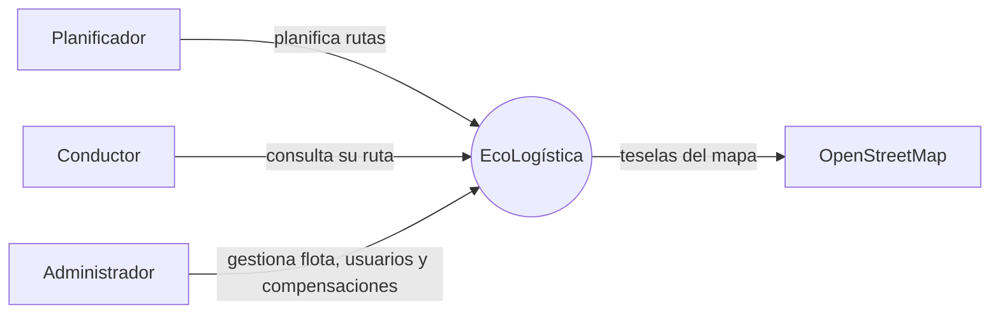
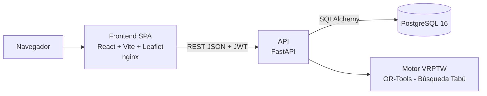
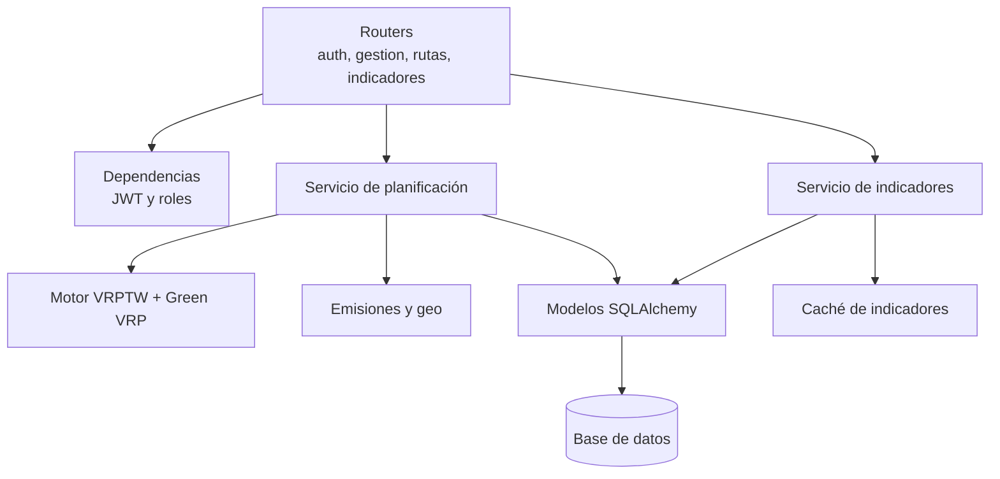

# Arquitectura de Software - Modelo C4

**Nombre del Proyecto:** EcoLogística - Optimizador de rutas sostenibles de última milla para DistriRápido S.A.C.

**Líder del Proyecto:** Fernando Rodrigo Chaupis Espinoza (Product Owner, Scrum Master y Developer; proyecto individual)

**Docente:** Daniel Gamarra Moreno

**Fecha:** 13/11/2026

**Versión:** 1.0.0

---

## Nivel 1: Diagrama de Contexto

## Nivel 2: Diagrama de Contenedores

## Nivel 3: Diagrama de Componentes (Contenedor API Backend)

## Descripción de Componentes Internos

| Componente | Carpeta | Responsabilidad |
|---|---|---|
| Routers | `app/api/routers` | Endpoints REST, validación de entrada y control por roles |
| Dependencias | `app/api/deps.py`, `app/api/paginacion.py` | Usuario autenticado, roles y paginación |
| Servicio de planificación | `app/services/planificacion.py` | Convierte la BD en una instancia del motor, resuelve, guarda y re-optimiza |
| Servicio de indicadores | `app/services/indicadores.py` | Dashboard, sostenibilidad y plan de compensación |
| Motor | `app/optimization/vrptw.py` | VRPTW + Green VRP con Búsqueda Tabú; no depende de la BD |
| Emisiones y geo | `app/optimization/emisiones.py`, `geo.py` | Factores de CO₂, distancias Haversine y conversión de horas |
| Seguridad | `app/core/security.py` | bcrypt, JWT y bloqueo por intentos fallidos |
| Caché | `app/core/cache.py` | Guarda indicadores 60 s y se limpia con cada escritura |

---

## Historial de control de cambios

| Versión | Fecha | Autor | Descripción |
|---|---|---|---|
| 1.0.0 | 13/11/2026 | Fernando Rodrigo Chaupis Espinoza | Versión inicial |
