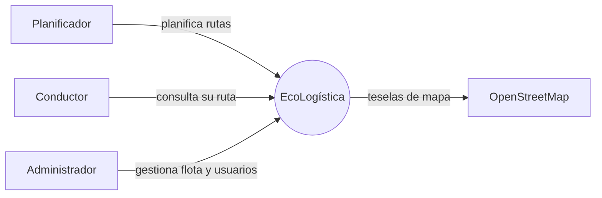
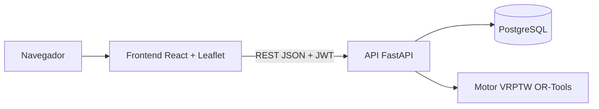

# Modelo C4

| Campo | Valor |
|---|---|
| Proyecto | EcoLogística - Optimizador de rutas sostenibles de última milla |
| Organización | DistriRápido S.A.C., Huancayo, Junín |
| Curso | Taller de Proyectos 2, Universidad Continental |
| Versión | 1.0.0 |
| Fecha | 13/11/2026 |
| Elaborado por | Fernando Rodrigo Chaupis Espinoza |
| Revisado por | Docente: Daniel Gamarra Moreno |

---

## Nivel 1, Contexto

## Nivel 2, Contenedores

## Nivel 3, Componentes del backend

| Componente | Carpeta | Responsabilidad |
|---|---|---|
| Routers | `app/api/routers` | Endpoints REST y control de roles |
| Servicios | `app/services` | Casos de uso: planificar, re-optimizar, indicadores |
| Motor | `app/optimization` | VRPTW + Green VRP, distancias, emisiones (sin dependencias de BD) |
| Modelos | `app/models.py` | Entidades SQLAlchemy |
| Seguridad | `app/core/security.py` | bcrypt, JWT, bloqueo de login |
