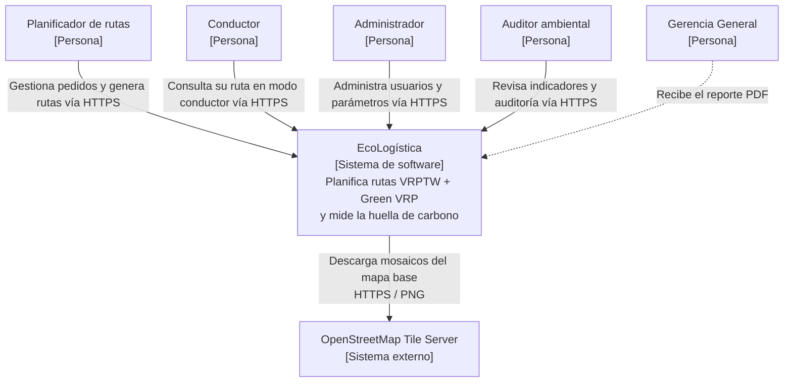
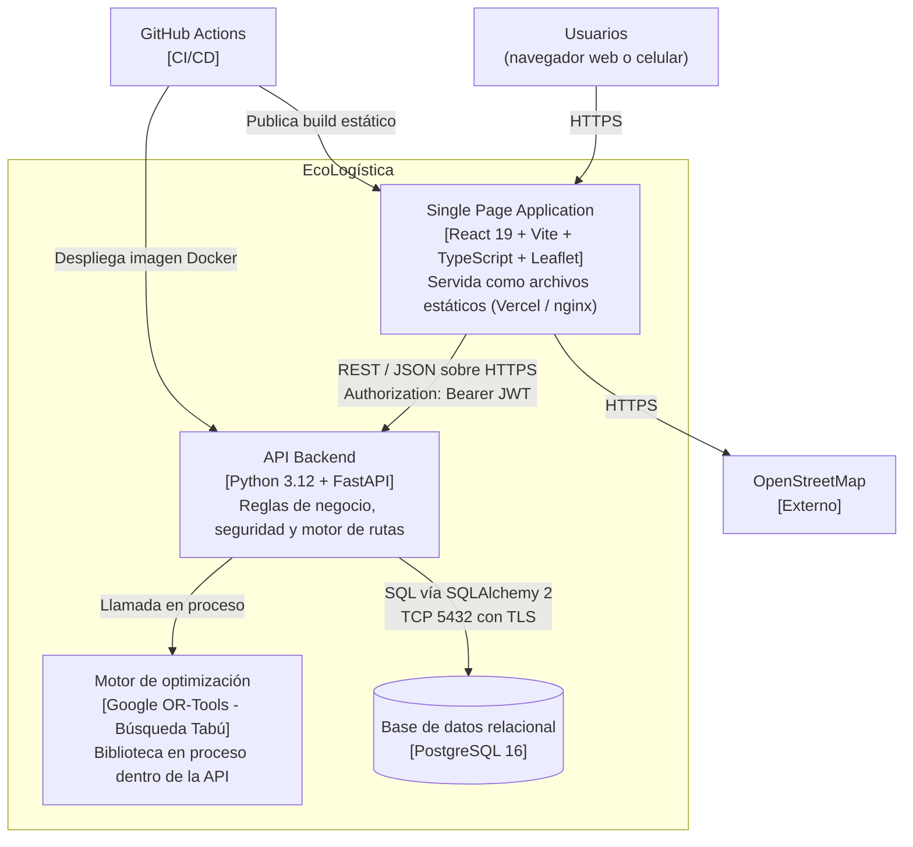
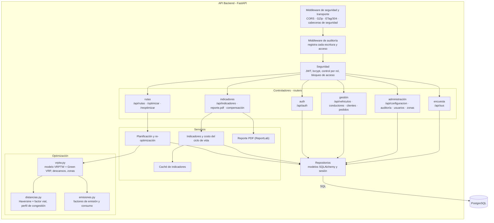

[← Volver al README Principal](../../README.md)

# Arquitectura de Software - Modelo C4

| Metadato | Valor |
|---|---|
| Nombre del Proyecto | EcoLogística - Optimizador de rutas sostenibles de última milla para DistriRápido S.A.C. |
| Integrantes | Fernando Rodrigo Chaupis Espinoza |
| Fecha | 19/11/2026 |
| Versión | 1.1.0 |

---
## Nivel 1: Diagrama de Contexto

| Elemento | Responsabilidad |
|---|---|
| EcoLogística | Gestiona flota, conductores, clientes y pedidos; calcula y re-optimiza rutas; mide CO₂ y costos. |
| OpenStreetMap | Mapa base de Huancayo Metropolitano (licencia ODbL). |

## Nivel 2: Diagrama de Contenedores

| Contenedor | Tecnología | Protocolo de comunicación |
|---|---|---|
| SPA | React, Vite, TypeScript, Leaflet | HTTPS hacia el usuario; REST/JSON con JWT hacia la API |
| API Backend | FastAPI, Pydantic, PyJWT, bcrypt, ReportLab | REST/JSON; respuestas comprimidas (GZip) con ETag |
| Motor de optimización | OR-Tools 9.12 | Llamada en proceso (sin red) |
| Base de datos | PostgreSQL 16 | SQL sobre TCP 5432 |

## Nivel 3: Diagrama de Componentes (contenedor API Backend)

| Componente | Responsabilidad | Ubicación en el código |
|---|---|---|
| Middleware | CORS, compresión, ETag/304, cabeceras de seguridad y auditoría | `backend/app/main.py` |
| Seguridad | Emisión y validación de JWT, hash bcrypt, dependencias por rol | `backend/app/core/security.py`, `backend/app/api/deps.py` |
| Controladores | Endpoints REST, validación de entrada con Pydantic, paginación | `backend/app/api/routers/` |
| Servicios | Casos de uso: planificar, re-optimizar, indicadores, PDF | `backend/app/services/` |
| Optimización | Modelo matemático independiente de la base de datos | `backend/app/optimization/` |
| Repositorios | Entidades y acceso a datos | `backend/app/models.py`, `backend/app/db.py` |

---

## Historial de control de cambios

| Versión | Fecha | Autor | Descripción |
|---|---|---|---|
| 1.0.0 | 11/09/2026 | Fernando Rodrigo Chaupis Espinoza | Versión inicial con niveles 1, 2 y 3 en Mermaid |
| 1.1.0 | 19/11/2026 | Fernando Rodrigo Chaupis Espinoza | Cambio de alcance del Sprint 4 (enunciado oficial del caso): protocolos y componentes del motor (descansos y zonas) en los niveles 1 a 3 |

[← Volver al README Principal](../../README.md)
