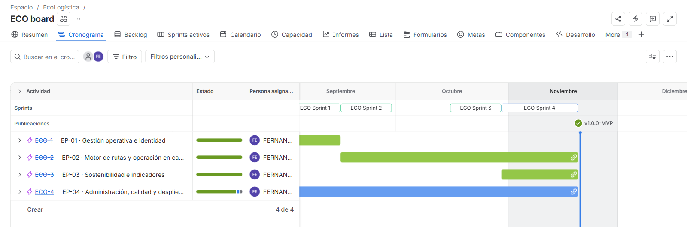
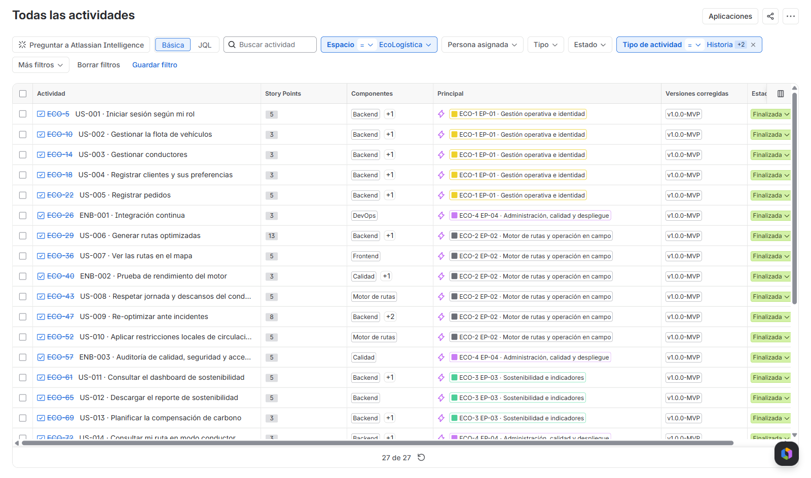
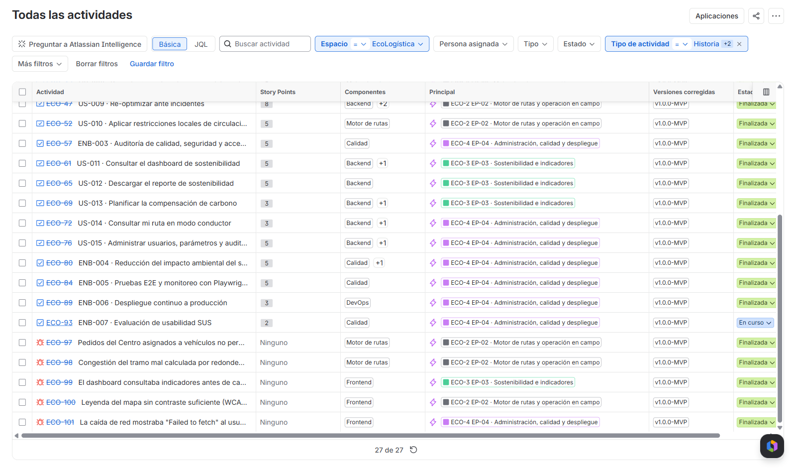
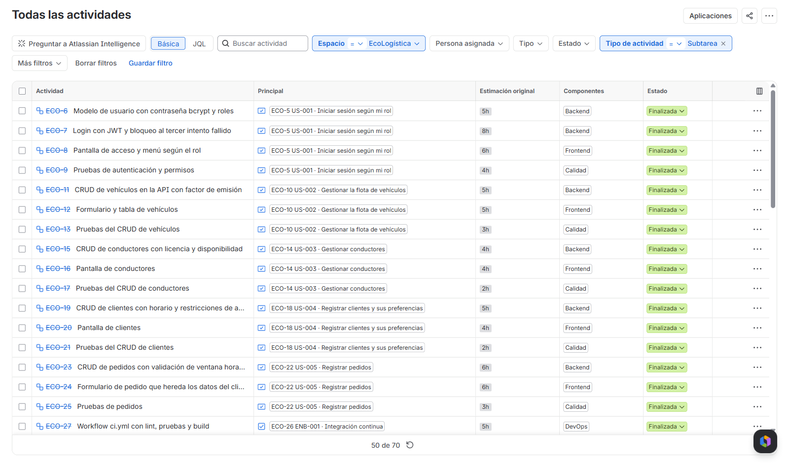
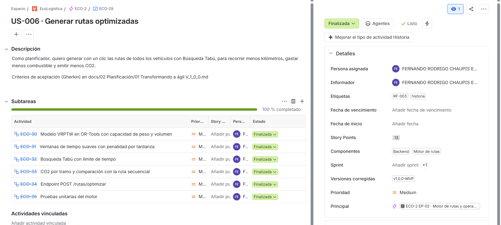
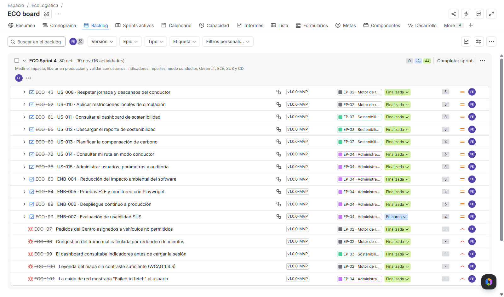
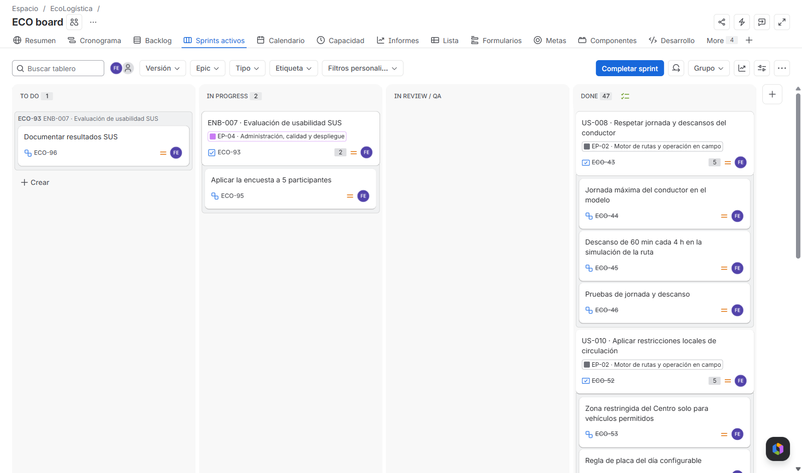
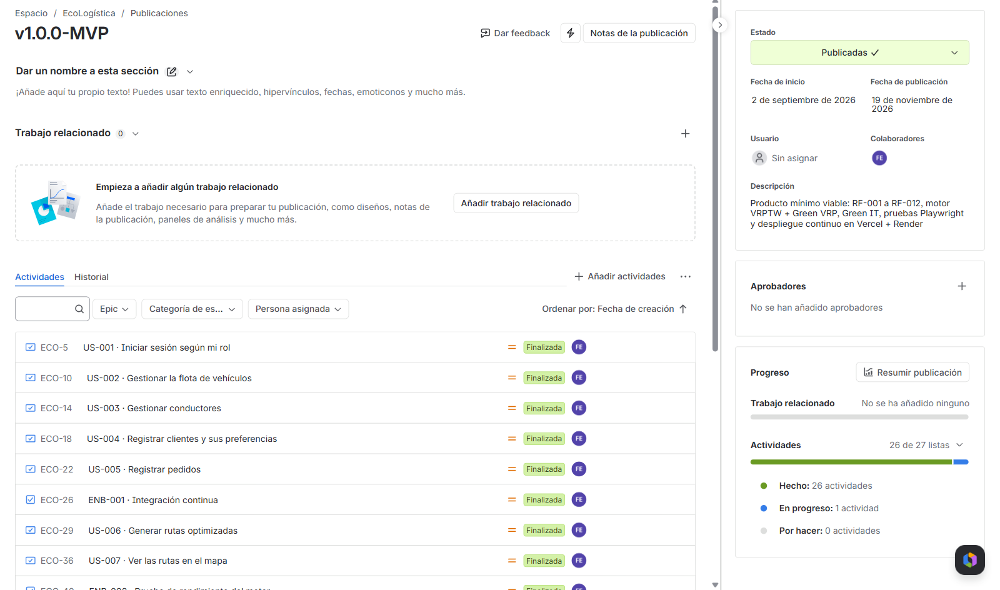

[← Volver al README Principal](../../README.md)

# Artefactos Jira - Evidencia de Configuración

**Nombre del Proyecto:** EcoLogística - Optimizador de rutas sostenibles de última milla para DistriRápido S.A.C.

**Líder del Proyecto:** Fernando Rodrigo Chaupis Espinoza (Product Owner, Scrum Master y Developer; proyecto individual)

**Docente:** Daniel Gamarra Moreno

**Fecha:** 19/11/2026
**Versión:** 1.1.0
---

## Configuración Previa Aplicada

| Elemento | Configuración en Jira Software |
|---|---|
| Sitio | `continental-team-tttzet5e.atlassian.net` |
| Proyecto | **EcoLogística**, clave **ECO**, plantilla Scrum gestionada por la empresa |
| Tablero | *ECO board* (Scrum) con columnas **To Do → In Progress → In Review / QA → Done** |
| Estimación | Story Points (serie de Fibonacci) en historias y enablers; estimación original en horas en las subtareas |
| Tipos de incidencia | Epic, Historia (US), Tarea (ENB, enablers técnicos), Subtarea y Error (bug) |
| Componentes | Backend, Frontend, Motor de rutas, DevOps y Calidad |
| Etiquetas | Requisito de origen (por ejemplo `RF-003` o `RNF-001`), `historia`, `enabler` y `bug` |
| Versión | `v1.0.0-MVP` (02/09/2026 - 19/11/2026) |

**Resumen del contenido del proyecto:**

| Tipo | Cantidad | Detalle |
|---|:-:|---|
| Épicas | 4 | EP-01 a EP-04, una por grupo de requisitos del documento [01 Transformando a ágil](<01 Transformando a ágil V_1_1_0.md>) |
| Historias de usuario | 15 | US-001 a US-015 |
| Enablers | 7 | ENB-001 a ENB-007 |
| Subtareas | 70 | Entre 2 h y 8 h cada una (ninguna supera 8 h); 331 h estimadas en total |
| Errores (bugs) | 5 | Defectos reales corregidos en el Sprint 4, enlazados a la historia afectada |
| Story Points | 102 | 22 + 21 + 23 + 36 por sprint |

---

## Evidencia 1: Roadmap del Proyecto

Cronograma de Jira con las 4 épicas, los 4 sprints y la publicación `v1.0.0-MVP`.

| Épica | Nombre | Inicio | Fin | Estado |
|---|---|---|---|---|
| EP-01 | Gestión operativa e identidad | 02/09/2026 | 15/09/2026 | Finalizada |
| EP-02 | Motor de rutas y operación en campo | 16/09/2026 | 19/11/2026 | Finalizada |
| EP-03 | Sostenibilidad e indicadores | 30/10/2026 | 19/11/2026 | Finalizada |
| EP-04 | Administración, calidad y despliegue | 02/09/2026 | 19/11/2026 | En curso (falta ENB-007) |

## Evidencia 2: Backlog Priorizado

Backlog ordenado por prioridad con Story Points (Fibonacci), componentes, épica y versión.

| Clave | ID | Título | Épica | SP | Componentes | Sprint |
|---|---|---|---|:-:|---|:-:|
| ECO-5 | US-001 | Iniciar sesión según mi rol | EP-01 | 5 | Backend, Frontend | 1 |
| ECO-10 | US-002 | Gestionar la flota de vehículos | EP-01 | 3 | Backend, Frontend | 1 |
| ECO-14 | US-003 | Gestionar conductores | EP-01 | 3 | Backend, Frontend | 1 |
| ECO-18 | US-004 | Registrar clientes y sus preferencias | EP-01 | 3 | Backend, Frontend | 1 |
| ECO-22 | US-005 | Registrar pedidos | EP-01 | 5 | Backend, Frontend | 1 |
| ECO-26 | ENB-001 | Integración continua | EP-04 | 3 | DevOps | 1 |
| ECO-29 | US-006 | Generar rutas optimizadas | EP-02 | 13 | Backend, Motor de rutas | 2 |
| ECO-36 | US-007 | Ver las rutas en el mapa | EP-02 | 5 | Frontend | 2 |
| ECO-40 | ENB-002 | Prueba de rendimiento del motor | EP-02 | 3 | Calidad, Motor de rutas | 2 |
| ECO-43 | US-008 | Respetar jornada y descansos del conductor | EP-02 | 5 | Motor de rutas | 3 → 4 |
| ECO-47 | US-009 | Re-optimizar ante incidentes | EP-02 | 8 | Backend, Frontend, Motor de rutas | 3 |
| ECO-52 | US-010 | Aplicar restricciones locales de circulación | EP-02 | 5 | Motor de rutas | 3 → 4 |
| ECO-57 | ENB-003 | Auditoría de calidad, seguridad y accesibilidad | EP-04 | 5 | Calidad | 3 |
| ECO-61 | US-011 | Consultar el dashboard de sostenibilidad | EP-03 | 5 | Backend, Frontend | 4 |
| ECO-65 | US-012 | Descargar el reporte de sostenibilidad | EP-03 | 5 | Backend | 4 |
| ECO-69 | US-013 | Planificar la compensación de carbono | EP-03 | 3 | Backend, Frontend | 4 |
| ECO-72 | US-014 | Consultar mi ruta en modo conductor | EP-04 | 3 | Backend, Frontend | 4 |
| ECO-76 | US-015 | Administrar usuarios, parámetros y auditoría | EP-04 | 5 | Backend, Frontend | 4 |
| ECO-80 | ENB-004 | Reducción del impacto ambiental del software | EP-04 | 5 | Calidad, Frontend | 4 |
| ECO-84 | ENB-005 | Pruebas E2E y monitoreo con Playwright | EP-04 | 5 | Calidad | 4 |
| ECO-89 | ENB-006 | Despliegue continuo a producción | EP-04 | 3 | DevOps | 4 |
| ECO-93 | ENB-007 | Evaluación de usabilidad SUS | EP-04 | 2 | Calidad | 4 |

US-008 y US-010 se planificaron en el Sprint 3, quedaron incompletas al cierre y pasaron al Sprint 4, tal como se
registró en la [Revisión del Sprint 3](<../03 Implementación/Sprint 03/01 Revisión del Sprint V_1_1_0.md>).

**Errores (bugs) registrados en el Sprint 4:**

| Clave | Error | Componente | Relacionado con |
|---|---|---|---|
| ECO-97 | Pedidos del Centro asignados a vehículos no permitidos | Motor de rutas | US-010 |
| ECO-98 | Congestión del tramo mal calculada por redondeo de minutos | Motor de rutas | US-008 |
| ECO-99 | El dashboard consultaba indicadores antes de cargar la sesión | Frontend | US-011 |
| ECO-100 | Leyenda del mapa sin contraste suficiente (WCAG 1.4.3) | Frontend | US-007 |
| ECO-101 | La caída de red mostraba "Failed to fetch" al usuario | Frontend | ENB-005 |

**Subtareas de 8 h o menos** (estimación original en horas) y detalle de una historia con sus subtareas:

## Evidencia 3: Sprint Planning y Sprint Goal

| Sprint | Fechas | Sprint Goal | Ítems | SP |
|---|---|---|---|:-:|
| ECO Sprint 1 | 02/09/2026 - 15/09/2026 | Base operativa: acceso por roles y registro de flota, conductores, clientes y pedidos con CI activo. | US-001 a US-005, ENB-001 | 22 |
| ECO Sprint 2 | 16/09/2026 - 29/09/2026 | Generar rutas optimizadas con Búsqueda Tabú y verlas en el mapa cumpliendo 45 s. | US-006, US-007, ENB-002 | 21 |
| ECO Sprint 3 | 16/10/2026 - 29/10/2026 | Rutas realistas y seguras: jornada y descansos, re-optimización, restricciones locales y auditoría de calidad. | US-008, US-009, US-010, ENB-003 | 23 |
| ECO Sprint 4 | 30/10/2026 - 19/11/2026 | Medir el impacto, liberar en producción y validar con usuarios: indicadores, reportes, modo conductor, Green IT, E2E, SUS y CD. | US-011 a US-015, ENB-004 a ENB-007 (+ US-008 y US-010) | 36 |

Los sprints 1, 2 y 3 están cerrados y el Sprint 4 está activo. La captura muestra la planificación del Sprint 4 con su
objetivo, los Story Points de cada ítem y los errores corregidos.

## Evidencia 4: Tablero Scrum Activo

Tablero del Sprint 4 con las columnas **To Do**, **In Progress**, **In Review / QA** y **Done**. Todo el trabajo del
sprint está en Done salvo ENB-007: la encuesta SUS ya está dentro de la aplicación (subtarea terminada), la aplicación a
los 5 participantes está en curso y la documentación de resultados está por hacer.

## Evidencia 5: Gestión de Versiones / Release

| Versión | Inicio | Publicación | Contenido |
|---|---|---|---|
| v1.0.0-MVP | 02/09/2026 | 19/11/2026 | RF-001 a RF-012, motor VRPTW + Green VRP con Búsqueda Tabú, reducción del impacto ambiental, pruebas Playwright y despliegue continuo en Vercel + Render (https://ecologistica.vercel.app). 26 de 27 ítems terminados; queda ENB-007. |

---

## Historial de control de cambios

| Versión | Fecha | Autor | Descripción |
|---|---|---|---|
| 1.0.0 | 13/11/2026 | Fernando Rodrigo Chaupis Espinoza | Versión inicial con el backlog en GitHub Issues |
| 1.1.0 | 19/11/2026 | Fernando Rodrigo Chaupis Espinoza | Proyecto Scrum en Jira Software con épicas, backlog con Story Points y componentes, subtareas, errores, 4 sprints, tablero con columna In Review / QA y release v1.0.0-MVP |

[← Volver al README Principal](../../README.md)
