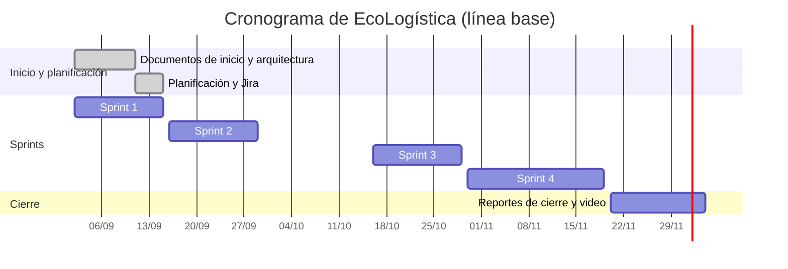

[← Volver al README Principal](../../README.md)

# Cronograma de Sprints

| Metadato | Valor |
|---|---|
| Nombre del Proyecto | EcoLogística - Optimizador de rutas sostenibles de última milla para DistriRápido S.A.C. |
| Líder del Proyecto | Fernando Rodrigo Chaupis Espinoza |
| Fecha | 15/09/2026 |
| Versión | 1.0.0 |

Documento complementario a los cuatro artefactos de planificación: fija la línea base de fechas que se usa en el
seguimiento (valor ganado, burndown y burnup).

---

## 1. Calendario

| Sprint | Inicio | Fin | Inspección del curso | Objetivo del sprint (Sprint Goal) | Ítems | SP |
|:-:|---|---|---|---|---|:-:|
| 1 | 02/09/2026 | 15/09/2026 | Sprint 1 | Base operativa: acceso por roles y registro de flota, conductores, clientes y pedidos con CI activo. | US-001 a US-005, ENB-001 | 22 |
| 2 | 16/09/2026 | 29/09/2026 | Sprint 2 | Generar rutas optimizadas con Búsqueda Tabú y verlas en el mapa cumpliendo 45 s. | US-006, US-007, ENB-002 | 21 |
| 3 | 16/10/2026 | 29/10/2026 | Sprint 3 (Inspección 03) | Rutas realistas y seguras: jornada y descansos, re-optimización, restricciones locales y auditoría de calidad. | US-008, US-009, US-010, ENB-003 | 23 |
| 4 | 30/10/2026 | 19/11/2026 | Inspección 04 (Green IT) e Inspección 05 (Sprint 4) | Medir el impacto, liberar en producción y validar con usuarios: indicadores, reportes, modo conductor, Green IT, E2E, SUS y CD. | US-011 a US-015, ENB-004 a ENB-007 | 36 |
| Cierre | 20/11/2026 | 04/12/2026 | Evaluación final y sustentación | Reportes de cierre, video y sustentación. | - | - |

Entre el 30/09 y el 15/10/2026 no hay sprint: corresponde a la evaluación parcial del semestre.

## 2. Hitos

| Hito | Fecha | Criterio de cumplimiento |
|---|---|---|
| H1 - Inicio y arquitectura | 11/09/2026 | 13 documentos en `docs/01 Inicio` |
| H2 - Planificación | 15/09/2026 | 4 artefactos en `docs/02 Planificación` y proyecto Jira configurado |
| H3 - Sprint 1 | 15/09/2026 | 4 documentos del sprint y CI en verde |
| H4 - Sprint 2 | 29/09/2026 | Motor de rutas ≤ 45 s y mapa |
| H5 - Sprint 3 | 29/10/2026 | 5 informes del Sprint 3 (revisión, retrospectiva, calidad, OWASP, WCAG) |
| H6 - Inspección 04 | 13/11/2026 | 2 documentos de reducción del impacto ambiental y `green-audit.yml` |
| H7 - Sprint 4 | 19/11/2026 | 4 documentos del Sprint 4 y 3 workflows en verde con despliegue a producción |
| H8 - Cierre | 04/12/2026 | 7 reportes de cierre, video y sustentación |

---

## Historial de control de cambios

| Versión | Fecha | Autor | Descripción |
|---|---|---|---|
| 1.0.0 | 15/09/2026 | Fernando Rodrigo Chaupis Espinoza | Versión inicial con 4 sprints |

[← Volver al README Principal](../../README.md)
