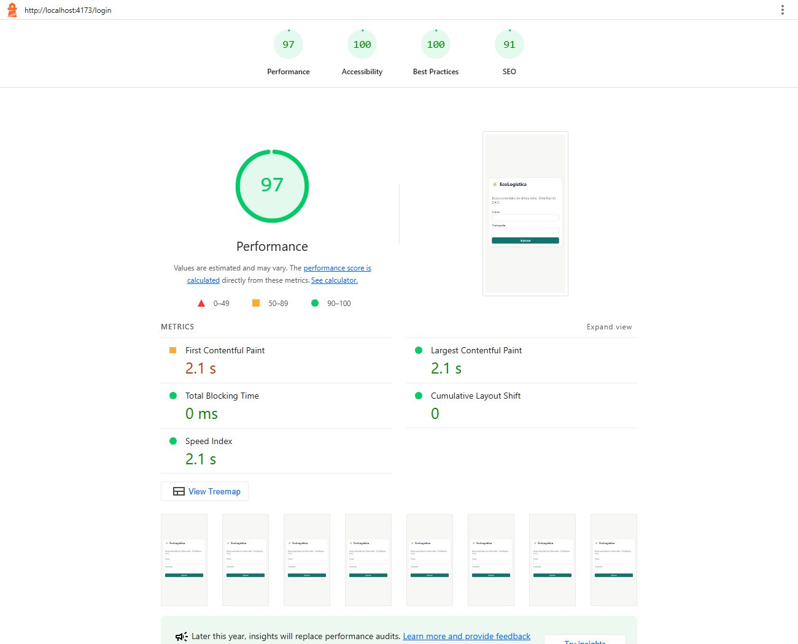
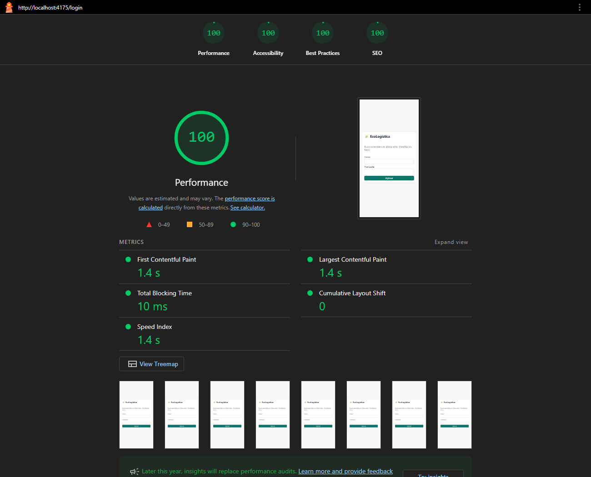

# Informe de reducción del impacto ambiental

| Campo | Valor |
|---|---|
| Proyecto | EcoLogística - Optimizador de rutas sostenibles de última milla |
| Organización | DistriRápido S.A.C. - Huancayo, Junín |
| Curso | Taller de Proyectos 2 - Universidad Continental |
| Entregable | Inspección 04 - Green IT |
| Versión | 1.0.0 |
| Fecha | 13/11/2026 |
| Elaborado por | Fernando Rodrigo Chaupis Espinoza |
| Revisado por | Docente: Daniel Gamarra Moreno |

---

## 1.1 Introducción y propósito

Este informe documenta las optimizaciones que aplicamos a EcoLogística para que consuma menos datos, menos
procesamiento y, por lo tanto, menos energía. Cada byte que viaja por la red y cada consulta que corre en el
servidor consume electricidad en centros de datos, redes y en el equipo del usuario. Reducirlos baja la huella
de carbono del software.

El proyecto ya busca reducir emisiones con el motor de rutas (menos kilómetros recorridos por la flota). En esta
inspección el foco está en el **propio software**: que la aplicación web sea liviana y eficiente.

Para medir el impacto usamos:

- **Lighthouse 12.6.1** (Chrome) sobre la pantalla de inicio de sesión, en modo móvil y escritorio. Se hicieron
  3 corridas por caso y se tomó la mediana (igual que Lighthouse CI).
- Un script de medición de la API con **300 pedidos, 15 vehículos y 9 rutas generadas**.
- El **Sustainable Web Design Model v4 (SWDM)** para convertir los bytes transferidos a CO₂.

Las dos mediciones se hicieron en la misma máquina y con el mismo servidor estático
(`frontend/scripts/servidor-estatico.mjs`): el "antes" con la opción `--plano` (sin compresión ni caché) sobre
el build anterior y el "después" sobre el build optimizado.

## 1.2 Diagnóstico inicial

Antes de las optimizaciones encontramos estos problemas:

- Todo el código de la aplicación (React, router y todas las pantallas excepto Rutas) se descargaba en un solo
  archivo de **232 KB** desde el login.
- El servidor no comprimía los archivos ni el JSON de la API.
- No había política de caché: el navegador volvía a descargar todo en cada visita.
- El navegador pedía un `favicon.ico` que no existía (solicitud desperdiciada) y no había `robots.txt`
  (Lighthouse SEO 91).
- `GET /api/pedidos` y `GET /api/rutas` devolvían **todos** los registros con todas sus columnas.
- `GET /api/rutas` hacía una consulta por cada parada y cada pedido (problema N+1).

### Métricas de referencia ANTES (login)

| Indicador | Móvil | Escritorio |
|---|:-:|:-:|
| Performance (Lighthouse) | **97** | 100 |
| Accesibilidad | 100 | 100 |
| Buenas prácticas | 100 | 100 |
| SEO | 91 | 91 |
| FCP | 2.1 s | 0.4 s |
| LCP | 2.1 s | 0.4 s |
| TBT | 0 ms | 0 ms |
| CLS | 0 | 0 |
| Speed Index | 2.1 s | 0.4 s |
| Transferencia total | **242.8 KB** (242 795 B) | 242.8 KB |
| Solicitudes | 4 (incluye `favicon.ico` inexistente) | 4 |
| Compresión de texto | No aprobado | No aprobado |
| Caché eficiente | No aprobado | No aprobado |
| CO₂e (SWDM v4) | **0.0815 g / visita** | |

### API ANTES (300 pedidos, 9 rutas)

| Endpoint | Registros | Bytes enviados | Tiempo |
|---|:-:|:-:|:-:|
| `GET /api/pedidos` | 300 | 75 526 B | 15.4 ms |
| `GET /api/rutas` | 9 | 102 858 B | 144.8 ms |
| `GET /api/vehiculos` | 15 | 1 900 B | 8.7 ms |
| `GET /api/indicadores` | - | 229 B | 19.2 ms |



## 1.3 Detalle técnico de las 8 optimizaciones

### 1. Consultas magras e índices

- El listado de pedidos usa `load_only` de SQLAlchemy y el esquema `PedidoResumen`: solo lee las 9 columnas que
  muestra la tabla (sin dirección, coordenadas ni fechas). Para editar, el frontend pide el registro completo con
  `GET /api/pedidos/{id}`.
- Las paradas de una ruta devuelven solo los datos que usa el mapa (`PedidoParada`: código, cliente, coordenadas y peso).
- `GET /api/rutas` usa `selectinload` para traer rutas, paradas, pedidos, vehículos y conductores en 5 consultas
  en lugar de una por cada parada (se elimina el N+1).
- Se agregaron índices en `rutas.estado`, `rutas.vehiculo_id`, `rutas.conductor_id`, `paradas.ruta_id` y
  `paradas.pedido_id` (PostgreSQL no indexa las llaves foráneas por defecto).

Archivos: `backend/app/api/routers/gestion.py`, `backend/app/api/routers/rutas.py`, `backend/app/models.py`, `backend/app/schemas.py`.

### 2. Paginación de 12 registros

- Nuevo módulo `backend/app/api/paginacion.py`: los listados de vehículos, conductores, pedidos y rutas aceptan
  `?pagina=&limite=` (12 por defecto, máximo 100) y devuelven el total en la cabecera `X-Total-Count`.
- La tabla genérica del frontend (`CrudPage.tsx`) muestra los controles Anterior / Siguiente.
- La pantalla Rutas pide solo las rutas vigentes: `GET /api/rutas?estado=PLANIFICADA,EN_CURSO`.

### 3. Imágenes WebP y AVIF

La aplicación no usa fotografías ni imágenes rasterizadas: los íconos del mapa se dibujan con HTML y CSS
(`L.divIcon`) en lugar de los PNG por defecto de Leaflet. El único recurso gráfico es el ícono de la pestaña, que
se convirtió a **SVG en línea** (ver optimización 6). Si en el futuro se agregan fotos de entregas, la regla de
la guía (documento 02) es servirlas en WebP o AVIF con `loading="lazy"`.

### 4. Code splitting con React.lazy y Suspense

- Todas las pantallas (Dashboard, Rutas, Pedidos, Flota, Conductores, Preferencias, Sostenibilidad) y el menú se
  cargan con `React.lazy` y `Suspense` (`frontend/src/main.tsx`). En el login solo se descarga lo necesario
  para mostrar el formulario.
- React, React DOM y React Router se separaron en su propio archivo (`manualChunks` en `vite.config.ts`). Como
  casi nunca cambian, el navegador los mantiene en caché aunque se publique una nueva versión de la app.
- Leaflet (154.9 KB) solo se descarga cuando el usuario abre la pantalla Rutas.

| Archivo inicial | Antes | Después |
|---|:-:|:-:|
| `index.js` (código de la app) | 232.2 KB | **7.2 KB** |
| `react.js` (librerías, en caché 1 año) | - | 219.4 KB |

### 5. Bibliotecas pesadas y API nativa

Se revisaron las dependencias del frontend. El proyecto solo usa `react`, `react-dom`, `react-router-dom` y
`leaflet`. No se incluyeron librerías pesadas que tienen reemplazo nativo:

| Librería evitada | Reemplazo nativo usado |
|---|---|
| axios | `fetch` |
| moment / dayjs | `Date` e `input type="date/time"` |
| lodash | métodos de `Array` y `Object` |
| Material UI / Bootstrap | CSS propio (3.3 KB) |
| Chart.js | Indicadores en tarjetas HTML |

En el backend, la compresión, el ETag y la caché se hicieron con la librería estándar de Python (`hashlib`,
`time`) y el middleware incluido en FastAPI, sin dependencias nuevas.

### 6. SVG crítico en línea y menos solicitudes

- El ícono de la pestaña ahora es un SVG en línea dentro de `index.html` (data URI). Se eliminó la solicitud a
  `favicon.ico`, que antes respondía con la página completa porque el archivo no existía.
- Se agregó `robots.txt` en `frontend/public/`. Antes esa ruta devolvía la página completa.
- Los íconos de paradas del mapa son HTML con CSS, no imágenes.
- El CSS de Leaflet va dentro del archivo de la pantalla Rutas, no como solicitud aparte en el login.

### 7. Caché en servidor y en cliente

- **Archivos estáticos:** los archivos de `/assets/` llevan hash en el nombre, así que se sirven con
  `Cache-Control: public, max-age=31536000, immutable`. El `index.html` usa `no-cache` para que siempre se
  revalide. Está configurado en `frontend/nginx.conf` (producción) y en `servidor-estatico.mjs`.
- **API con ETag:** todas las respuestas GET de la API llevan un `ETag` (hash BLAKE2b del cuerpo) y
  `Cache-Control: private, no-cache`. Si el navegador ya tiene la misma versión, el servidor responde **304 sin
  cuerpo** (`backend/app/main.py`).
- **Caché en el servidor:** los indicadores del dashboard, el reporte de sostenibilidad y el plan de
  compensación se guardan 60 s en memoria (`backend/app/core/cache.py`). Se limpia automáticamente en cuanto
  alguien registra o modifica datos.

### 8. Compresión Brotli y Gzip

- **Frontend:** el build genera versiones `.br` (Brotli nivel 11) y `.gz` (Gzip nivel 9) de cada archivo de
  texto mayor a 1 KB (plugin `precomprimir` en `vite.config.ts`). El servidor entrega la versión comprimida según
  la cabecera `Accept-Encoding`, sin gastar CPU en cada visita.
- **Backend:** `GZipMiddleware` de FastAPI comprime las respuestas JSON mayores a 1 KB.

## 1.4 Tabla comparativa

### Pantalla de login (Lighthouse móvil)

| Indicador | Antes | Después | Mejora |
|---|:-:|:-:|:-:|
| Performance | 97 | **100** | +3 |
| SEO | 91 | **100** | +9 |
| FCP | 2.1 s | **1.4 s** | -33 % |
| LCP | 2.1 s | **1.4 s** | -33 % |
| TBT | 0 ms | 10 ms | sin cambio real (ambos muy por debajo de 200 ms) |
| Speed Index | 2.1 s | **1.4 s** | -33 % |
| Transferencia | 242 795 B | **66 697 B** | **-72.5 %** |
| Compresión de texto | No aprobado | Aprobado | |
| Caché eficiente | No aprobado | Aprobado | |
| CO₂e por visita | 0.0815 g | **0.0224 g** | -72.5 % |

En escritorio el puntaje se mantuvo en 100, el SEO subió de 91 a 100 y FCP/LCP bajaron de 0.4 s a 0.3 s.

### Archivos descargados en el login

| Antes | Bytes | Después | Bytes |
|---|:-:|---|:-:|
| login (HTML) | 690 | login (HTML) | 1 252 |
| index.js | 238 040 | index.js | 2 893 |
| index.css | 3 375 | react.js (Brotli) | 61 310 |
| favicon.ico (inexistente) | 690 | index.css | 1 242 |
| **Total** | **242 795** | **Total** | **66 697** |

En una segunda visita los archivos de `/assets/` ya están en caché: solo se transfiere el HTML (1 252 B).

### API (300 pedidos, 15 vehículos, 9 rutas)

| Endpoint | Antes | Después | Reducción | Tiempo antes | Tiempo después |
|---|:-:|:-:|:-:|:-:|:-:|
| `GET /api/pedidos` | 75 526 B (300 registros) | **267 B** (12 registros, gzip) | -99.6 % | 15.4 ms | 4.4 ms |
| `GET /api/rutas` | 102 858 B | **10 993 B** (gzip) | -89.3 % | 144.8 ms | **19.1 ms** |
| `GET /api/vehiculos` | 1 900 B | **226 B** (gzip) | -88.1 % | 8.7 ms | 5.3 ms |
| `GET /api/indicadores` | 229 B | 229 B | - | 19.2 ms | **3.1 ms** (caché) |
| Respuesta repetida (ETag) | cuerpo completo | **304 sin cuerpo** | -100 % | | |

## 1.5 Análisis con el Sustainable Web Design Model v4

**Metodología:**

```text
E (g CO2e) = Ancho de banda (GB) × 0.815 kWh/GB × 442 g CO2e/kWh
```

- 0.815 kWh/GB: energía de centros de datos, redes y dispositivos por GB transferido (SWDM).
- 442 g CO₂e/kWh: intensidad de carbono promedio global de la electricidad.
- GB = bytes / 1 073 741 824.

### Escenario de referencia: anti-patrón de la consigna (8.4 MB)

- Transferencia: 8.4 MB = 0.0082031 GB
- Energía: 0.0082031 × 0.815 = 0.0066855 kWh
- Emisiones: 0.0066855 × 442 = **2.955 g CO₂e / visita**

### Escenario anterior: 242 795 bytes

- Transferencia: 0.0002261 GB
- Energía: 0.0001843 kWh
- Emisiones: **0.0815 g CO₂e / visita**

### Escenario posterior: 66 697 bytes

- Transferencia: 0.0000621 GB
- Energía: 0.0000506 kWh
- Emisiones: **0.0224 g CO₂e / visita**

### Ahorro y proyección anual (500 000 visitas)

| Escenario | g CO₂e / visita | kg CO₂e / año |
|---|:-:|:-:|
| Anti-patrón 8.4 MB | 2.955 | 1 477.5 |
| EcoLogística antes | 0.0815 | 40.7 |
| **EcoLogística después** | **0.0224** | **11.2** |
| **Ahorro frente a nuestra versión anterior** | 0.0591 | **29.5 kg** |
| **Ahorro frente al anti-patrón** | 2.933 | **1 466.3 kg** |

Con un promedio de 22 kg de CO₂ absorbidos por árbol al año (el mismo supuesto que usa el módulo de
compensación del sistema), el ahorro frente a nuestra versión anterior equivale a lo que absorben unos
**1.3 árboles por año**, y frente al anti-patrón, unos **67 árboles por año**.

Este cálculo solo considera la pantalla de inicio. En el uso diario el ahorro es mayor por la API: un
planificador que abre Pedidos y Rutas descargaba 178 384 B y ahora descarga 11 260 B (-93.7 %), y las
consultas repetidas responden con 304 sin cuerpo.

## 1.6 Evidencias

Todas las evidencias están en la carpeta [`evidencias/`](evidencias/):

| Evidencia | Archivo |
|---|---|
| Lighthouse móvil ANTES | [lighthouse-antes-movil.png](evidencias/lighthouse-antes-movil.png) · [reporte HTML](evidencias/lighthouse-antes-movil.html) |
| Lighthouse escritorio ANTES | [lighthouse-antes-escritorio.png](evidencias/lighthouse-antes-escritorio.png) · [reporte HTML](evidencias/lighthouse-antes-escritorio.html) |
| Lighthouse móvil DESPUÉS | [lighthouse-despues-movil.png](evidencias/lighthouse-despues-movil.png) · [reporte HTML](evidencias/lighthouse-despues-movil.html) |
| Lighthouse escritorio DESPUÉS | [lighthouse-despues-escritorio.png](evidencias/lighthouse-despues-escritorio.png) · [reporte HTML](evidencias/lighthouse-despues-escritorio.html) |
| Métricas consolidadas (Lighthouse, API y SWDM) | [metricas-consolidadas.json](evidencias/metricas-consolidadas.json) |
| Pruebas automáticas de paginación, gzip y ETag | `backend/tests/test_api.py` (`test_paginacion_de_pedidos`, `test_gzip_y_etag`, `test_filtro_rutas_por_varios_estados`) |
| Auditoría continua | `.github/workflows/green-audit.yml` + `frontend/lighthouserc.cjs` |



### Cómo repetir la medición

```bash
cd frontend
npm run build
node scripts/servidor-estatico.mjs dist 4173
npx lighthouse http://localhost:4173/login --view
```

## Historial de control de cambios

| Versión | Fecha | Autor | Descripción |
|---|---|---|---|
| 1.0.0 | 13/11/2026 | Fernando Chaupis | Informe de la Inspección 04 con mediciones antes y después |
