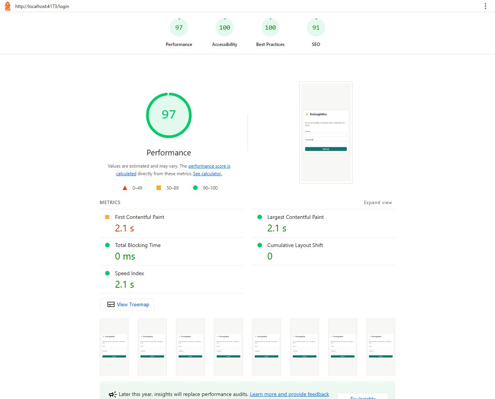

[← Volver al README Principal](../../../README.md)

# Informe de reducción del impacto ambiental

| Campo | Valor |
|---|---|
| Proyecto | EcoLogística - Optimizador de rutas sostenibles de última milla |
| Organización | DistriRápido S.A.C. - Huancayo, Junín |
| Curso | Taller de Proyectos 2 - Universidad Continental |
| Entregable | Inspección 04 - Green IT |
| Versión | 1.2.0 |
| Fecha | 19/11/2026 |
| Elaborado por | Fernando Rodrigo Chaupis Espinoza |
| Revisado por | Docente: Daniel Gamarra Moreno |

---

## 1.1 Introducción y propósito

Este informe documenta las optimizaciones que aplicamos a EcoLogística para que consuma menos datos, menos
procesamiento y, por lo tanto, menos energía. Cada byte que viaja por la red y cada consulta que corre en el
servidor consume electricidad en centros de datos, redes y en el equipo del usuario. Reducirlos baja la huella
de carbono del software.

El proyecto ya busca reducir emisiones con el motor de rutas (menos kilómetros recorridos por la flota). En esta
inspección el foco está en el **propio software**: que la aplicación web sea liviana y eficiente.

Para medir el impacto usamos:

- **Lighthouse 12.6.1** (Chrome) en modo *user flow* sobre 4 pantallas (Login, Dashboard, Pedidos y Rutas), en
  escritorio y móvil, más el login medido aparte con la mediana de 3 corridas.
- Un script de medición de la API con **300 pedidos, 15 vehículos y 9 rutas generadas**.
- El **Sustainable Web Design Model v4 (SWDM)**, con sus coeficientes oficiales, para convertir los bytes a CO₂.

Las dos mediciones se hicieron en la misma máquina y con el mismo servidor estático
(`frontend/scripts/servidor-estatico.mjs`): el "antes" con la opción `--plano` (sin compresión ni caché) sobre
el build anterior y el "después" sobre el build optimizado.

## 1.2 Diagnóstico inicial

Antes de las optimizaciones encontramos estos problemas:

- Todo el código de la aplicación (React, router y todas las pantallas excepto Rutas) se descargaba en un solo
  archivo de **232 KB** desde el login.
- El servidor no comprimía los archivos ni el JSON de la API.
- No había política de caché: el navegador volvía a descargar todo en cada visita.
- El navegador pedía un `favicon.ico` que no existía (solicitud desperdiciada) y no había `robots.txt`
  (Lighthouse SEO 91).
- `GET /api/pedidos` y `GET /api/rutas` devolvían **todos** los registros con todas sus columnas.
- `GET /api/rutas` hacía una consulta por cada parada y cada pedido (problema N+1).

### Métricas de referencia ANTES (login)

| Indicador | Móvil | Escritorio |
|---|:-:|:-:|
| Performance (Lighthouse) | **97** | 100 |
| Accesibilidad | 100 | 100 |
| Buenas prácticas | 100 | 100 |
| SEO | 91 | 91 |
| FCP | 2.1 s | 0.4 s |
| LCP | 2.1 s | 0.4 s |
| TBT | 0 ms | 0 ms |
| CLS | 0 | 0 |
| Speed Index | 2.1 s | 0.4 s |
| Transferencia total | **242.8 KB** (242 795 B) | 242.8 KB |
| Solicitudes | 4 (incluye `favicon.ico` inexistente) | 4 |
| Compresión de texto | No aprobado | No aprobado |
| Caché eficiente | No aprobado | No aprobado |
| CO₂e (SWDM v4) | **0.0815 g / visita** | |

### API ANTES (300 pedidos, 9 rutas)

| Endpoint | Registros | Bytes enviados | Tiempo |
|---|:-:|:-:|:-:|
| `GET /api/pedidos` | 300 | 75 526 B | 15.4 ms |
| `GET /api/rutas` | 9 | 102 858 B | 144.8 ms |
| `GET /api/vehiculos` | 15 | 1 900 B | 8.7 ms |
| `GET /api/indicadores` | - | 229 B | 19.2 ms |



## 1.3 Detalle técnico de las 8 optimizaciones

### 1. Consultas magras e índices

- El listado de pedidos usa `load_only` de SQLAlchemy y el esquema `PedidoResumen`: solo lee las 9 columnas que
  muestra la tabla (sin dirección, coordenadas ni fechas). Para editar, el frontend pide el registro completo con
  `GET /api/pedidos/{id}`.
- Las paradas de una ruta devuelven solo los datos que usa el mapa (`PedidoParada`: código, cliente, coordenadas y peso).
- `GET /api/rutas` usa `selectinload` para traer rutas, paradas, pedidos, vehículos y conductores en 5 consultas
  en lugar de una por cada parada (se elimina el N+1).
- Se agregaron índices en `rutas.estado`, `rutas.vehiculo_id`, `rutas.conductor_id`, `paradas.ruta_id` y
  `paradas.pedido_id` (PostgreSQL no indexa las llaves foráneas por defecto).

Archivos: `backend/app/api/routers/gestion.py`, `backend/app/api/routers/rutas.py`, `backend/app/models.py`, `backend/app/schemas.py`.

**Código ANTES** (`backend/app/api/routers/rutas.py`, commit `3b1724c`): una consulta por cada parada (N+1) y todas las columnas.

```python
return db.scalars(select(Ruta).order_by(Ruta.id.desc())).all()   # paradas y pedidos con carga perezosa
```

**Código DESPUÉS** (commit `2ab9ad9`): 5 consultas en total, columnas mínimas e índices.

```python
q.options(selectinload(Ruta.paradas).selectinload(Parada.pedido),
          selectinload(Ruta.vehiculo), selectinload(Ruta.conductor))
estado: Mapped[str] = mapped_column(String(12), default="PLANIFICADA", index=True)
```

### 2. Paginación de 12 registros

- Nuevo módulo `backend/app/api/paginacion.py`: los listados de vehículos, conductores, pedidos y rutas aceptan
  `?pagina=&limite=` (12 por defecto, máximo 100) y devuelven el total en la cabecera `X-Total-Count`.
- La tabla genérica del frontend (`CrudPage.tsx`) muestra los controles Anterior / Siguiente.
- La pantalla Rutas pide solo las rutas vigentes: `GET /api/rutas?estado=PLANIFICADA,EN_CURSO`.

**Código ANTES** (`backend/app/api/routers/crud.py`, commit `f5eb0b0`): devolvía la tabla completa.

```python
def listar(activo: bool | None = None, db: Session = Depends(get_db), _=Depends(get_current_user)):
    q = select(model).order_by(model.id)
    return db.scalars(q).all()
```

**Código DESPUÉS** (commit `2ab9ad9`): 12 registros por página y total en `X-Total-Count`.

```python
def listar(response: Response, activo: bool | None = None, p: Pagina = Depends(params_pagina),
           db: Session = Depends(get_db), _=Depends(get_current_user)):
    q = select(model).order_by(model.id)
    return paginar(db, q, p, response)   # LIMIT 12 OFFSET (pagina-1)*12
```

### 3. Imágenes WebP y AVIF

La aplicación no usa fotografías ni imágenes rasterizadas: los íconos del mapa se dibujan con HTML y CSS
(`L.divIcon`) en lugar de los PNG por defecto de Leaflet. El único recurso gráfico es el ícono de la pestaña, que
se convirtió a **SVG en línea** (ver optimización 6). Si en el futuro se agregan fotos de entregas, la regla de
la guía (documento 02) es servirlas en WebP o AVIF con `loading="lazy"`.

**Código ANTES** (`MapaRutas.tsx`): marcador por defecto de Leaflet, que descarga `marker-icon.png` y `marker-shadow.png`.

```tsx
L.marker([p.pedido.lat, p.pedido.lng]).addTo(grupo);
```

**Código DESPUÉS** (commit `edf5779`): ícono hecho con HTML y CSS, sin imágenes rasterizadas.

```tsx
L.marker([p.pedido.lat, p.pedido.lng], {
  icon: L.divIcon({ className: 'pin', html: `<span style="background:${color}">${p.orden}</span>` }),
}).addTo(grupo);
```

### 4. Code splitting con React.lazy y Suspense

- Todas las pantallas (Dashboard, Rutas, Pedidos, Flota, Conductores, Preferencias, Sostenibilidad) y el menú se
  cargan con `React.lazy` y `Suspense` (`frontend/src/main.tsx`). En el login solo se descarga lo necesario
  para mostrar el formulario.
- React, React DOM y React Router se separaron en su propio archivo (`manualChunks` en `vite.config.ts`). Como
  casi nunca cambian, el navegador los mantiene en caché aunque se publique una nueva versión de la app.
- Leaflet (154.9 KB) solo se descarga cuando el usuario abre la pantalla Rutas.

| Archivo inicial | Antes | Después |
|---|:-:|:-:|
| `index.js` (código de la app) | 232.5 KB | **7.6 KB** |
| `react.js` (librerías, en caché 1 año) | - | 220.5 KB |

**Código ANTES** (`frontend/src/main.tsx`, commit `c0ec63b`): todas las pantallas en el archivo inicial.

```tsx
import { Layout } from './components/Layout';
import { Conductores, Pedidos, Preferencias, Vehiculos } from './pages/Gestion';
import { Inicio, SostenibilidadPage } from './pages/Paneles';
```

**Código DESPUÉS** (commit `edf5779`): cada pantalla se descarga al entrar en ella.

```tsx
const Layout = lazy(() => import('./components/Layout').then((m) => ({ default: m.Layout })));
const Pedidos = lazy(() => import('./pages/Gestion').then((m) => ({ default: m.Pedidos })));
const cargando = (texto: string, hijo: ReactNode) => (
  <Suspense fallback={<p className="muted">{texto}</p>}>{hijo}</Suspense>
);
```

### 5. Bibliotecas pesadas y API nativa

Se revisaron las dependencias del frontend. El proyecto solo usa `react`, `react-dom`, `react-router-dom` y
`leaflet`. No se incluyeron librerías pesadas que tienen reemplazo nativo:

| Librería evitada | Reemplazo nativo usado |
|---|---|
| axios | `fetch` |
| moment / dayjs | `Date` e `input type="date/time"` |
| lodash | métodos de `Array` y `Object` |
| Material UI / Bootstrap | CSS propio (3.3 KB) |
| Chart.js | Indicadores en tarjetas HTML |

En el backend, la compresión, el ETag y la caché se hicieron con la librería estándar de Python (`hashlib`,
`time`) y el middleware incluido en FastAPI, sin dependencias nuevas.

**Alternativa descartada** (patrón habitual con axios, +13 KB comprimidos):

```ts
import axios from 'axios';
const { data } = await axios.get(`${API_URL}/pedidos`, { headers: { Authorization: `Bearer ${token}` } });
```

**Código implementado** (`frontend/src/api.ts`): `fetch` nativo del navegador, 0 KB de dependencias.

```ts
const resp = await fetch(`${API_URL}${ruta}`, { headers: { Authorization: `Bearer ${token}` } });
if (!resp.ok) throw new ApiError(resp.status, mensajeError((await resp.json()).detail, resp.status));
```

### 6. SVG crítico en línea y menos solicitudes

- El ícono de la pestaña ahora es un SVG en línea dentro de `index.html` (data URI). Se eliminó la solicitud a
  `favicon.ico`, que antes respondía con la página completa porque el archivo no existía.
- Se agregó `robots.txt` en `frontend/public/`. Antes esa ruta devolvía la página completa.
- Los íconos de paradas del mapa son HTML con CSS, no imágenes.
- El CSS de Leaflet va dentro del archivo de la pantalla Rutas, no como solicitud aparte en el login.

**Código ANTES** (`frontend/index.html`): el navegador pedía `/favicon.ico`, que no existía y devolvía la página completa.

```html
<title>EcoLogística</title>
```

**Código DESPUÉS** (commit `edf5779`): ícono SVG en línea, sin solicitud adicional.

```html
<link rel="icon" href="data:image/svg+xml,%3Csvg xmlns='http://www.w3.org/2000/svg' viewBox='0 0 32 32'%3E...%3C/svg%3E" />
```

### 7. Caché en servidor y en cliente

- **Archivos estáticos:** los archivos de `/assets/` llevan hash en el nombre, así que se sirven con
  `Cache-Control: public, max-age=31536000, immutable`. El `index.html` usa `no-cache` para que siempre se
  revalide. Está configurado en `frontend/nginx.conf` (producción) y en `servidor-estatico.mjs`.
- **API con ETag:** todas las respuestas GET de la API llevan un `ETag` (hash BLAKE2b del cuerpo) y
  `Cache-Control: private, no-cache`. Si el navegador ya tiene la misma versión, el servidor responde **304 sin
  cuerpo** (`backend/app/main.py`).
- **Caché en el servidor:** los indicadores del dashboard, el reporte de sostenibilidad y el plan de
  compensación se guardan 60 s en memoria (`backend/app/core/cache.py`). Se limpia automáticamente en cuanto
  alguien registra o modifica datos.

**Código ANTES** (`backend/app/main.py`): cada GET devolvía el cuerpo completo aunque no hubiera cambios.

```python
app.add_middleware(CORSMiddleware, allow_origins=settings.lista_cors)
```

**Código DESPUÉS** (commit `2ab9ad9`): ETag con respuesta 304 y caché de indicadores de 60 s.

```python
etag = 'W/"' + hashlib.blake2b(cuerpo, digest_size=10).hexdigest() + '"'
if request.headers.get("if-none-match") == etag:
    return Response(status_code=304, headers={"ETag": etag, "Cache-Control": "private, no-cache"})

return cache.obtener(("dashboard", desde, hasta), lambda: indicadores.dashboard(db, desde, hasta))
```

### 8. Compresión Brotli y Gzip

- **Frontend:** el build genera versiones `.br` (Brotli nivel 11) y `.gz` (Gzip nivel 9) de cada archivo de
  texto mayor a 1 KB (plugin `precomprimir` en `vite.config.ts`). El servidor entrega la versión comprimida según
  la cabecera `Accept-Encoding`, sin gastar CPU en cada visita.
- **Backend:** `GZipMiddleware` de FastAPI comprime las respuestas JSON mayores a 1 KB.

**Código ANTES** (`frontend/vite.config.ts`): build sin archivos precomprimidos.

```ts
export default defineConfig({ plugins: [react()] });
```

**Código DESPUÉS** (commits `edf5779` y `2ab9ad9`): `.br` y `.gz` generados en el build y JSON comprimido en la API.

```ts
writeFileSync(`${ruta}.gz`, gzipSync(datos, { level: 9 }));
writeFileSync(`${ruta}.br`, brotliCompressSync(datos, { params: { [constants.BROTLI_PARAM_QUALITY]: 11 } }));
```

```python
app.add_middleware(GZipMiddleware, minimum_size=1000)
```

## 1.4 Tabla comparativa

Medición con **Lighthouse 12.6.1 en modo user flow** (`flujo.mjs`): el usuario inicia sesión una vez y recorre
Dashboard, Pedidos y Rutas con la sesión iniciada, igual que en el uso real. El "antes" es el build anterior a las
optimizaciones servido sin compresión ni caché; el "después" es el build actual. La API es la misma en ambos casos
(su mejora se midió aparte, más abajo).

### Umbrales de la consigna

Score ≥ 90 · FCP ≤ 1.0 s · LCP ≤ 1.4 s · TBT ≤ 85 ms · CLS ≤ 0.02 · transferencia ≤ 1.1 MB. Perfil de referencia:
**escritorio** (igual criterio que los demás equipos del curso); el perfil móvil se reporta como información
adicional.

### Escritorio - ANTES

| Pantalla | Score | FCP | LCP | TBT | CLS | Peso | Solicitudes | Cumple los 6 umbrales |
|---|:-:|:-:|:-:|:-:|:-:|:-:|:-:|---|
| Login | 100 | 0.44 s | 0.44 s | 0 ms | 0 | 242 795 B | 4 | Sí |
| Dashboard | 100 | 0.44 s | 0.57 s | 0 ms | 0.012 | 243 585 B | 7 | Sí |
| Pedidos | 100 | 0.44 s | 0.56 s | 0 ms | 0.012 | 243 985 B | 7 | Sí |
| Rutas | 94 | 0.46 s | 1.68 s | 0 ms | 0.004 | 738 824 B | 25 | No (LCP) |

### Escritorio - DESPUÉS

| Pantalla | Score | FCP | LCP | TBT | CLS | Peso | Solicitudes | Cumple los 6 umbrales |
|---|:-:|:-:|:-:|:-:|:-:|:-:|:-:|---|
| Login | 100 | 0.32 s | 0.32 s | 0 ms | 0 | 68 156 B | 4 | Sí |
| Dashboard | 100 | 0.18 s | 0.26 s | 0 ms | 0.012 | 1 524 B | 9 | Sí |
| Pedidos | 100 | 0.19 s | 0.3 s | 0 ms | 0.014 | 4 840 B | 9 | Sí |
| Rutas | 98 | 0.23 s | 1.07 s | 0 ms | 0.016 | 371 959 B | 26 | Sí |

**Después de las optimizaciones las 4 pantallas cumplen los 6 umbrales en escritorio.** Antes, la pantalla Rutas no
cumplía el LCP.

### Móvil (información adicional)

ANTES:

| Pantalla | Score | FCP | LCP | TBT | CLS | Peso | Solicitudes | Cumple los 6 umbrales |
|---|:-:|:-:|:-:|:-:|:-:|:-:|:-:|---|
| Login | 97 | 2.1 s | 2.25 s | 0 ms | 0 | 242 795 B | 4 | No (FCP, LCP) |
| Dashboard | 95 | 2.1 s | 2.56 s | 0 ms | 0.019 | 243 585 B | 7 | No (FCP, LCP) |
| Pedidos | 95 | 2.1 s | 2.56 s | 0 ms | 0.019 | 243 985 B | 7 | No (FCP, LCP) |
| Rutas | 77 | 2.19 s | 5.51 s | 0 ms | 0.019 | 643 153 B | 19 | No (Score, FCP, LCP) |

DESPUÉS:

| Pantalla | Score | FCP | LCP | TBT | CLS | Peso | Solicitudes | Cumple los 6 umbrales |
|---|:-:|:-:|:-:|:-:|:-:|:-:|:-:|---|
| Login | 100 | 1.35 s | 1.35 s | 0 ms | 0 | 68 156 B | 4 | No (FCP) |
| Dashboard | 100 | 0.62 s | 0.92 s | 61 ms | 0.019 | 1 524 B | 9 | Sí |
| Pedidos | 99 | 0.69 s | 1.07 s | 106 ms | 0.021 | 4 840 B | 9 | No (TBT, CLS) |
| Rutas | 92 | 0.92 s | 3.29 s | 72 ms | 0.019 | 276 330 B | 20 | No (LCP) |

En móvil (red 4G lenta simulada) mejoran todas las pantallas, pero el login sigue con FCP de 1.35 s y Rutas con LCP
alto porque el mapa descarga teselas de OpenStreetMap, que son imágenes de un servidor externo. Se registran como
mejora pendiente.

### Antes vs. después por pantalla (escritorio)

| Pantalla | Indicador | Antes | Después | Mejora |
|---|---|:-:|:-:|:-:|
| Login | FCP | 0.44 s | 0.32 s | -27.3 % |
| Login | LCP | 0.44 s | 0.32 s | -27.3 % |
| Login | Peso | 242 795 B | 68 156 B | -71.9 % |
| Login | Score | 100 | 100 | +0 |
| Dashboard | FCP | 0.44 s | 0.18 s | -59.1 % |
| Dashboard | LCP | 0.57 s | 0.26 s | -54.4 % |
| Dashboard | Peso | 243 585 B | 1 524 B | -99.4 % |
| Dashboard | Score | 100 | 100 | +0 |
| Pedidos | FCP | 0.44 s | 0.19 s | -56.8 % |
| Pedidos | LCP | 0.56 s | 0.3 s | -46.4 % |
| Pedidos | Peso | 243 985 B | 4 840 B | -98.0 % |
| Pedidos | Score | 100 | 100 | +0 |
| Rutas | FCP | 0.46 s | 0.23 s | -50.0 % |
| Rutas | LCP | 1.68 s | 1.07 s | -36.3 % |
| Rutas | Peso | 738 824 B | 371 959 B | -49.7 % |
| Rutas | Score | 94 | 98 | +4 |

En las pantallas con sesión el peso baja casi a cero porque los archivos de `/assets/` ya están en la caché del
navegador (optimización 7); antes se volvían a descargar en cada pantalla. El peso de Rutas incluye las teselas del
mapa de OpenStreetMap.

### Sesión completa (login + 3 pantallas, escritorio)

| | Antes | Después | Reducción |
|---|:-:|:-:|:-:|
| Bytes transferidos | 1,469,189 B | 446,479 B | **69.6 %** |

### Archivos JavaScript del build

| Archivo | Antes | Después |
|---|:-:|:-:|
| `index.js` (código inicial de la app) | 238 040 B | **7 823 B** |
| `react.js` (librerías, en caché 1 año) | - | 225 757 B |
| `Rutas.js` (mapa, solo al abrir Rutas) | 154 920 B | 155 395 B |

### API (300 pedidos, 15 vehículos, 9 rutas)

| Endpoint | Antes | Después | Reducción | Tiempo antes | Tiempo después |
|---|:-:|:-:|:-:|:-:|:-:|
| `GET /api/pedidos` | 75 526 B (300 registros) | **267 B** (12 registros, gzip) | -99.6 % | 15.4 ms | 4.4 ms |
| `GET /api/rutas` | 102 858 B | **10 993 B** (gzip) | -89.3 % | 144.8 ms | **19.1 ms** |
| `GET /api/vehiculos` | 1 900 B | **226 B** (gzip) | -88.1 % | 8.7 ms | 5.3 ms |
| `GET /api/indicadores` | 229 B | 229 B | - | 19.2 ms | **3.1 ms** (caché) |
| Respuesta repetida (ETag) | cuerpo completo | **304 sin cuerpo** | -100 % | | |

## 1.5 Análisis con el Sustainable Web Design Model v4

**Metodología (SWDM v4, https://sustainablewebdesign.org/estimating-digital-emissions/):**

```text
g CO2e (primera visita) = GB × 0,300 kWh/GB × 494 g CO2e/kWh = GB × 148,2
g CO2e (visita media)   = primera visita × 0,755
GB = bytes / 1 000 000 000   (gigabyte decimal)
```

- 0,300 kWh/GB es la suma de las intensidades operativa (0,194) e incorporada (0,106) de centros de datos, redes y
  dispositivos de la versión 4 del modelo.
- 494 g CO₂e/kWh es la intensidad global de la red eléctrica que usa el modelo por defecto.
- 0,755 es el factor de visita media del modelo (parte de los visitantes vuelve y ya tiene archivos en caché).
- El ejemplo de cátedra usa 0,815 kWh/GB y 442 g/kWh, que son coeficientes de la versión 3 del modelo; aquí se
  aplican los de la versión 4.

### Pantalla de login

| Escenario | Bytes | GB | g CO₂e primera visita | g CO₂e visita media |
|---|:-:|:-:|:-:|:-:|
| Ejemplo de cátedra (8,4 MB) | 8 400 000 | 0,0084 | 1.2449 | 0.9399 |
| EcoLogística antes | 242,795 | 0.000243 | 0.0360 | 0.0272 |
| **EcoLogística después** | **68,156** | **0.000068** | **0.0101** | **0.0076** |

### Proyección anual (500 000 visitas)

| Escenario | kg CO₂e / año (primera visita) | kg CO₂e / año (visita media) |
|---|:-:|:-:|
| Ejemplo de cátedra 8,4 MB | 622.44 | 469.94 |
| EcoLogística antes (login) | 17.99 | 13.58 |
| **EcoLogística después (login)** | **5.05** | **3.81** |
| **Ahorro frente a nuestra versión anterior** | **12.94** | **9.77** |

Sesión completa de un planificador (login + Dashboard + Pedidos + Rutas): 0.2177 g antes y 0.0662 g
después por sesión; con 500 000 sesiones al año, 108.87 kg frente a 33.08 kg
(**75.79 kg CO₂e menos al año**).

Con 22 kg de CO₂ absorbidos por árbol al año (supuesto del módulo de compensación), el ahorro de la sesión completa
equivale a lo que absorben unos **3.4 árboles por año**.

## 1.6 Evidencias

Todas las evidencias están en la carpeta [`evidencias/`](evidencias/):

| Evidencia | Archivo |
|---|---|
| Lighthouse user flow escritorio ANTES (4 pantallas) | [flujo-antes-escritorio.html](evidencias/flujo-antes-escritorio.html) · [json](evidencias/flujo-antes-escritorio.json) |
| Lighthouse user flow escritorio DESPUÉS (4 pantallas) | [flujo-despues-escritorio.html](evidencias/flujo-despues-escritorio.html) · [json](evidencias/flujo-despues-escritorio.json) |
| Lighthouse user flow móvil ANTES | [flujo-antes-movil.html](evidencias/flujo-antes-movil.html) · [json](evidencias/flujo-antes-movil.json) |
| Lighthouse user flow móvil DESPUÉS | [flujo-despues-movil.html](evidencias/flujo-despues-movil.html) · [json](evidencias/flujo-despues-movil.json) |
| Login (mediana de 3 corridas) antes y después | [lighthouse-antes-movil.png](evidencias/lighthouse-antes-movil.png) · [lighthouse-despues-movil.png](evidencias/lighthouse-despues-movil.png) · reportes HTML |
| Cálculo SWDM v4 | [swdm-v4-resultados.json](evidencias/swdm-v4-resultados.json) |
| Métricas de la API | [metricas-consolidadas.json](evidencias/metricas-consolidadas.json) |
| Pruebas automáticas de paginación, gzip y ETag | `backend/tests/test_api.py` |
| Auditoría continua con los 6 umbrales | `.github/workflows/green-audit.yml` + `frontend/lighthouserc.cjs` |


### Cómo repetir la medición

```bash
cd frontend
npm run build
node scripts/servidor-estatico.mjs dist 4175
npx lighthouse http://localhost:4175/login --preset=desktop --view
```

## Historial de control de cambios

| Versión | Fecha | Autor | Descripción |
|---|---|---|---|
| 1.0.0 | 13/11/2026 | Fernando Chaupis | Informe de la Inspección 04 con mediciones antes y después |
| 1.1.0 | 14/11/2026 | Fernando Chaupis | Medición de 4 pantallas con sesión iniciada (escritorio y móvil), tabla de los 6 umbrales de la consigna y cálculo con los coeficientes oficiales de SWDM v4 |
| 1.2.0 | 19/11/2026 | Fernando Chaupis | Código ANTES y DESPUÉS en las 8 optimizaciones y enlace de retorno al README |

[← Volver al README Principal](../../../README.md)
