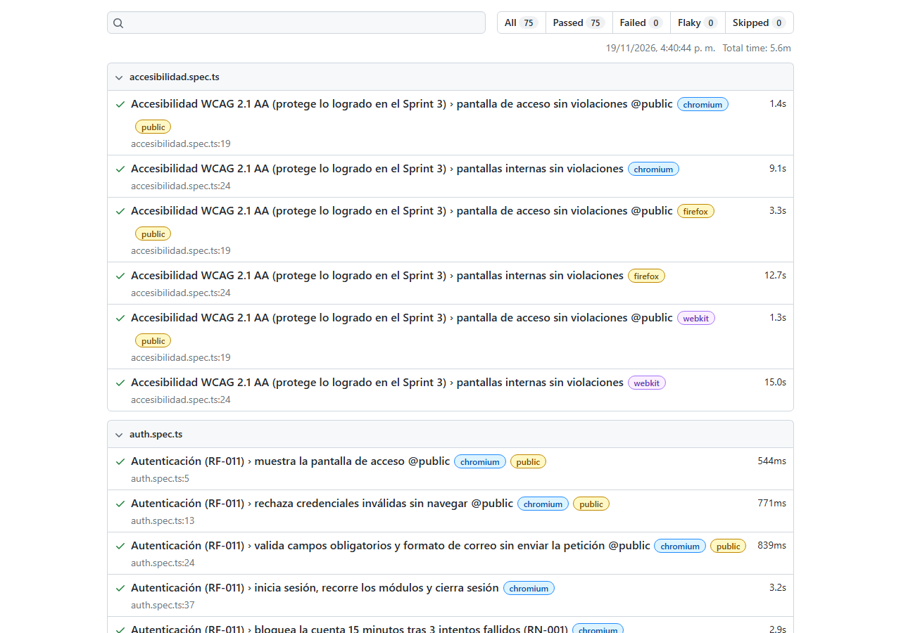
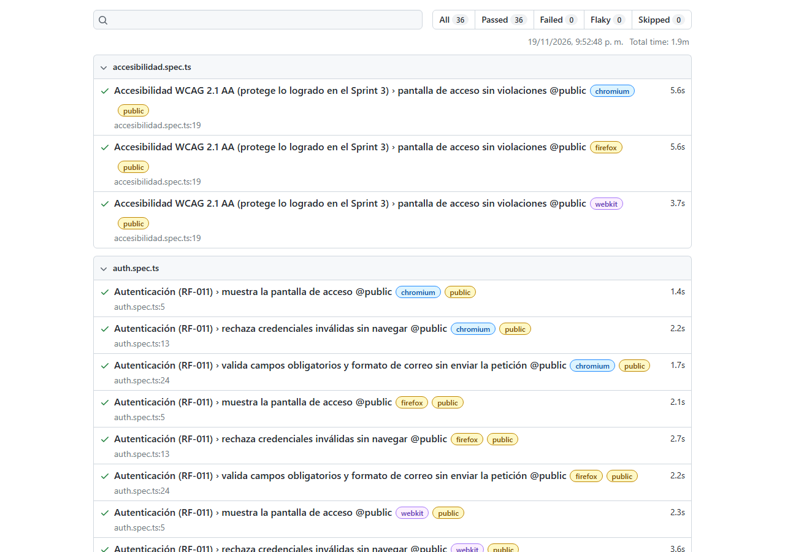

[← Volver al README Principal](../../../README.md)

# Análisis de pruebas E2E y monitoreo con Playwright

| Campo | Detalle |
|---|---|
| Proyecto | EcoLogística - Optimizador de rutas sostenibles de última milla para DistriRápido S.A.C. |
| Líder del proyecto | Fernando Rodrigo Chaupis Espinoza |
| Herramienta | `@playwright/test` 1.52.0 (TypeScript) |
| Navegadores | Chromium, Firefox y WebKit (perfiles *Desktop Chrome*, *Desktop Firefox* y *Desktop Safari*) |
| Historia técnica | ENB-005 - Pruebas E2E y monitoreo con Playwright |
| Pull Request | [FernandoR0/ecologistica#20](https://github.com/FernandoR0/ecologistica/pull/20) |
| Versión del documento | V_1_0_0 · 19/11/2026 |

## 1. Resumen de resultados

| Ejecución | Entorno | Resultado | Evidencia |
|---|---|---|---|
| Local, Windows 11, 19/11/2026 | Build de producción (`vite preview`) + API FastAPI real sobre una base aislada `e2e_test.db` | **75/75 aprobadas (100 %)**: 25 casos por navegador, 0 inestables | [resultados-playwright.json](evidencias/local-20261119/resultados-playwright.json) · [reporte HTML](evidencias/local-20261119/reporte-html.png) |
| Producción, 19/11/2026 | [ecologistica.vercel.app](https://ecologistica.vercel.app) (Vercel) + API en Render con PostgreSQL 16, pruebas `@public` de solo lectura | **36/36 aprobadas (100 %)**: 12 casos por navegador | [resultados-playwright.json](evidencias/produccion-20261119/resultados-playwright.json) · [reporte HTML](evidencias/produccion-20261119/reporte-html.png) · [métricas](evidencias/produccion-20261119/resumen-metricas.md) |
| GitHub Actions `tests.yml` | Ubuntu, PostgreSQL 16 como servicio, matriz de 3 navegadores | Se ejecuta en cada push y Pull Request a `main` y `develop` | [Workflow Tests](https://github.com/FernandoR0/ecologistica/actions/workflows/tests.yml) |



## 2. Configuración del entorno de pruebas

### 2.1 Arquitectura de carpetas

```text
frontend/
├── playwright.config.ts            # navegadores, servidores, reportes y modo producción
├── tsconfig.e2e.json               # verificación de tipos de la suite (npm run lint)
└── e2e/
    ├── auth.spec.ts                # acceso, validaciones, recorrido de módulos, bloqueo por intentos, auditor
    ├── gestion.spec.ts             # flota, clientes, pedidos y conductores con reglas de negocio
    ├── rutas.spec.ts               # Búsqueda Tabú, mapa, re-optimización, reporte PDF y modo conductor
    ├── rendimiento.spec.ts         # TTFB, FCP, LCP y tiempos de API
    ├── disponibilidad.spec.ts      # códigos HTTP, sondeos p50/p95 y resiliencia ante fallos
    ├── accesibilidad.spec.ts       # axe-core WCAG 2.1 AA en 10 pantallas
    └── support/
        ├── fixtures.ts             # usuarios de prueba, inicio de sesión, token de API y registro de métricas
        ├── global-setup.ts         # limpia las métricas antes de cada corrida
        ├── resumen-metricas.mjs    # tabla Markdown para el resumen del job de GitHub Actions
        └── exportar-evidencias.mjs # resultados versionables y captura del reporte HTML
backend/scripts/servidor_e2e.py     # levanta la API real sobre una base *test* recién creada
```

### 2.2 `playwright.config.ts`

La suite prueba el sistema real, no simulaciones: Playwright levanta dos servidores antes de las pruebas.

1. **API FastAPI** con `python -m scripts.servidor_e2e`: rechaza cualquier base cuyo nombre no contenga `test`, la
   recrea, carga los datos de demostración de Huancayo y arranca uvicorn en el puerto 8010.
2. **Frontend de producción** con `vite preview` en el puerto 4173: sirve el mismo `dist/` que se despliega y reenvía
   `/api` a la API de pruebas.

```ts
export default defineConfig({
  testDir: './e2e',
  globalSetup: './e2e/support/global-setup.ts',
  fullyParallel: false,
  forbidOnly: !!process.env.CI,
  retries: 0,
  workers: 1,                                   // los 3 navegadores comparten la base de pruebas
  grep: externo ? /@public/ : undefined,        // contra producción solo pruebas de lectura
  reporter: [['list'], ['html', { open: 'never', outputFolder: 'playwright-report' }],
             ['json', { outputFile: 'test-results/results.json' }], ['junit', { outputFile: 'test-results/junit.xml' }]],
  use: { baseURL: externo ?? 'http://127.0.0.1:4173', locale: 'es-PE', timezoneId: 'America/Lima',
         trace: 'retain-on-failure', screenshot: 'only-on-failure',
         video: process.env.CI ? 'retain-on-failure' : 'off' },
  projects: [
    { name: 'chromium', use: { ...devices['Desktop Chrome'] } },
    { name: 'firefox', use: { ...devices['Desktop Firefox'] } },
    { name: 'webkit', use: { ...devices['Desktop Safari'] } },
  ],
  webServer: externo ? undefined : [ /* API FastAPI :8010 y vite preview :4173 */ ],
});
```

Decisiones:

- **Sin reintentos** (`retries: 0`): un fallo intermitente no se oculta.
- **Un solo worker:** los tres navegadores escriben en la misma base y el plan de rutas toma todos los pedidos
  pendientes; en paralelo un navegador "robaría" los pedidos de otro.
- **Datos únicos por navegador:** cada prueba genera códigos con el prefijo del navegador y la hora
  (`unico()` en `fixtures.ts`).
- **Modo producción:** con `E2E_BASE_URL` no se levantan servidores y solo corren las pruebas etiquetadas `@public`,
  que no inician sesión ni escriben datos.
- **Video solo en CI:** en Windows la ruta del video de WebKit supera los 260 caracteres; en Linux (GitHub Actions)
  se graba ante fallos.

### 2.3 Integración en GitHub Actions

El job `e2e` de [`tests.yml`](../../../.github/workflows/tests.yml) usa la matriz `browser: [chromium, firefox, webkit]`,
un contenedor de servicio `postgres:16-alpine` con la base `ecologistica_e2e_test`, instala solo el navegador del job
(`npx playwright install --with-deps`) y publica `playwright-report-<navegador>` y `playwright-results-<navegador>`
como artifacts. El job `monitoreo-produccion` corre cada 6 horas las pruebas `@public` contra producción.

## 3. Pruebas End-to-End

### 3.1 Casos de prueba

| # | Archivo | Caso | Tipo | `@public` |
|:-:|---|---|---|:-:|
| 1 | auth | Muestra la pantalla de acceso (HTTP 200, título y campos) | Autenticación | Sí |
| 2 | auth | Rechaza credenciales inválidas (401, alerta, sin navegar) | Autenticación | Sí |
| 3 | auth | Valida campos obligatorios y formato de correo sin enviar petición | Validación de formulario | Sí |
| 4 | auth | Inicia sesión, recorre 6 módulos (`aria-current`) y cierra sesión | Flujo principal | No |
| 5 | auth | Bloquea la cuenta 15 minutos al tercer intento fallido (RN-001) | Seguridad | No |
| 6 | auth | El auditor solo consulta: no ve "Generar rutas" | Control de acceso | No |
| 7 | gestion | Registra un vehículo, verifica en la API su factor de emisión (0,2978) y rechaza la placa duplicada | Flujo y regla de negocio | No |
| 8 | gestion | Cliente con horario y punto de referencia; el pedido los hereda (verificado en la API) | Flujo de negocio | No |
| 9 | gestion | Ventana que termina antes de empezar: 422 y alerta | Validación | No |
| 10 | gestion | Licencia B-IIc para un furgón: rechazada (RN-015) | Regla de negocio | No |
| 11 | rutas | Genera el plan con Búsqueda Tabú y lo muestra en el mapa con tramos y congestión | Flujo principal | No |
| 12 | rutas | Re-optimiza ante un accidente y registra el incidente con su nueva ruta | Flujo de negocio | No |
| 13 | rutas | Descarga el reporte PDF y muestra el costo del ciclo de vida | Flujo de negocio | No |
| 14 | rutas | Modo conductor: siguiente entrega y "Entregado" | Flujo de negocio | No |
| 15 | rendimiento | TTFB, FCP y LCP del acceso dentro del presupuesto | Rendimiento | Sí |
| 16 | rendimiento | APIs de 5 módulos en menos de 500 ms | Rendimiento | No |
| 17 | disponibilidad | `/api/health` responde 200 `{"status":"ok"}` | Disponibilidad | Sí |
| 18 | disponibilidad | Interfaz y recursos estáticos sin respuestas ≥ 400 | Disponibilidad | Sí |
| 19 | disponibilidad | Proxy `/api`: 401 sin token, 404 en ruta inexistente, 401 con credenciales malas | Disponibilidad | Sí |
| 20 | disponibilidad | 10 sondeos consecutivos por destino con p50 y p95 | Disponibilidad | Sí |
| 21 | disponibilidad | Pérdida de conexión: mensaje comprensible y botón habilitado | Resiliencia | Sí |
| 22 | disponibilidad | Backend 503: mensaje de indisponibilidad con su código | Resiliencia | Sí |
| 23 | disponibilidad | API lenta (1,5 s): botón "Ingresando…" deshabilitado y luego el resultado | Resiliencia | Sí |
| 24 | accesibilidad | Acceso sin violaciones WCAG 2.1 AA | Accesibilidad | Sí |
| 25 | accesibilidad | 9 pantallas internas sin violaciones WCAG 2.1 AA | Accesibilidad | No |

### 3.2 Código fuente relevante

Flujo de negocio con verificación independiente en la API (`e2e/gestion.spec.ts`, extracto):

```ts
await fp.getByLabel('Código').fill(codigo);
await fp.getByRole('combobox', { name: /^Cliente/ }).selectOption({ label: nombre });
await fp.getByLabel('Peso (kg)').fill('80');
await fp.getByLabel('Prioridad').selectOption('EXPRESS');
await fp.getByRole('button', { name: 'Guardar' }).click();

const completo = await (await request.get(`${API}/pedidos/${resumen.id}`, { headers: h })).json();
expect(completo).toMatchObject({ ventana_inicio: '09:00', ventana_fin: '12:00', estado: 'PENDIENTE', prioridad: 'EXPRESS' });
```

Re-optimización con trazabilidad del incidente (`e2e/rutas.spec.ts`, extracto):

```ts
await form.getByLabel('Tipo').selectOption('ACCIDENTE');
await form.getByLabel('Descripción').fill('Choque en Av. Ferrocarril');
await form.getByRole('button', { name: 'Re-optimizar' }).click();
await expect(page.getByText(`re-optimizada de #${ruta.id}`).first()).toBeVisible({ timeout: 60_000 });
const incidentes = await (await request.get(`${API}/rutas/${ruta.id}/incidentes`, { headers: h })).json();
expect(incidentes[0]).toMatchObject({ tipo: 'ACCIDENTE', demora_min: 30 });
```

Los selectores usan roles y etiquetas accesibles (`getByRole`, `getByLabel`), los mismos que usa un lector de pantalla:
las pruebas también protegen la accesibilidad lograda en el Sprint 3.

### 3.3 Resultados de ejecución

| Ejecución | Chromium | Firefox | WebKit | Tasa de éxito |
|---|:-:|:-:|:-:|:-:|
| Local, 19/11/2026 (build de producción + API real) | 25/25 | 25/25 | 25/25 | **100 %** |
| Duración total de la corrida | | | | 5,6 min |

Detalle por caso, navegador y duración: [resultados-playwright.json](evidencias/local-20261119/resultados-playwright.json).

## 4. Monitoreo de rendimiento

### 4.1 Método

`rendimiento.spec.ts` lee las métricas que mide el propio navegador:

- **TTFB:** `responseStart − startTime` de *Navigation Timing*.
- **FCP:** entrada `first-contentful-paint` de *Paint Timing*.
- **LCP:** `PerformanceObserver` de `largest-contentful-paint` con `buffered: true`. WebKit no expone esta API; se
  registra como "no soportado" en lugar de inventar un valor.
- **Tiempo de API:** `responseEnd` del *Resource Timing* de la petición real de cada pantalla.

Presupuestos: TTFB < 800 ms, FCP < 1 800 ms, LCP < 2 500 ms (umbral "bueno" de Core Web Vitals) y API < 500 ms (RNF-003).

### 4.2 Resultados (local, 19/11/2026)

**Pantalla de acceso (Web Vitals):**

| Navegador | TTFB | FCP | LCP | Bytes transferidos |
|---|:-:|:-:|:-:|:-:|
| Chromium | 5 ms | 192 ms | 192 ms | 79 288 |
| Firefox | 14 ms | 214 ms | 252 ms | 79 288 |
| WebKit | 9 ms | 193 ms | No soportado | 79 288 |

**Tiempos de respuesta de la API (primera carga de cada pantalla):**

| Endpoint | Chromium | Firefox | WebKit | Presupuesto |
|---|:-:|:-:|:-:|:-:|
| `GET /api/pedidos` | 27 ms | 54 ms | 31 ms | < 500 ms ✔ |
| `GET /api/vehiculos` | 37 ms | 20 ms | 20 ms | < 500 ms ✔ |
| `GET /api/conductores` | 37 ms | 29 ms | 43 ms | < 500 ms ✔ |
| `GET /api/clientes` | 31 ms | 24 ms | 16 ms | < 500 ms ✔ |
| `GET /api/indicadores` | 27 ms | 23 ms | 10 ms | < 500 ms ✔ |

Archivos: `chromium-web-vitals.json`, `firefox-tiempos-api.json`, etc. en [evidencias/local-20261119](evidencias/local-20261119/).

## 5. Disponibilidad y resiliencia

### 5.1 Códigos de estado HTTP verificados

| Petición | Esperado | Resultado (3 navegadores) |
|---|---|:-:|
| `GET /login` (interfaz) | 200, `text/html` | 200 |
| Recursos estáticos del acceso | Ninguno ≥ 400 | Correcto |
| `GET /api/health` | 200 `{"status":"ok"}` | 200 |
| `GET /api/vehiculos` sin token | 401 | 401 |
| `GET /api/ruta-inexistente` | 404 | 404 |
| `POST /api/auth/login` con credenciales inválidas | 401 | 401 |
| Tercer intento fallido de acceso | 423 | 423 |

### 5.2 Sondeos de disponibilidad (10 peticiones consecutivas por destino)

| Navegador | Destino | Disponibilidad | p50 | p95 |
|---|---|:-:|:-:|:-:|
| Chromium | Interfaz (`/login`) | 10/10 (100 %) | 8 ms | 11 ms |
| Chromium | API (`/api/health`) | 10/10 (100 %) | 14 ms | 19 ms |
| Firefox | Interfaz | 10/10 (100 %) | 10 ms | 21 ms |
| Firefox | API | 10/10 (100 %) | 11 ms | 15 ms |
| WebKit | Interfaz | 10/10 (100 %) | 10 ms | 20 ms |
| WebKit | API | 10/10 (100 %) | 13 ms | 18 ms |

### 5.3 Manejo de errores de red

`disponibilidad.spec.ts` intercepta la petición de acceso con `page.route()` para simular tres fallos y verifica que el
usuario reciba un mensaje comprensible:

```ts
await page.route('**/api/auth/login', (route) => route.abort('internetdisconnected'));
await expect(page.getByRole('alert'))
  .toHaveText('No se pudo conectar con el servidor. Revisa tu conexión e inténtalo nuevamente.');
```

| Fallo simulado | Mensaje mostrado | Resultado |
|---|---|:-:|
| Sin conexión | "No se pudo conectar con el servidor. Revisa tu conexión e inténtalo nuevamente." | ✔ 3 navegadores |
| Backend 503 | "El servicio no está disponible en este momento. Inténtalo nuevamente en unos segundos. (Error 503)" | ✔ 3 navegadores |
| API lenta (1,5 s) | Botón "Ingresando…" deshabilitado y luego "Credenciales inválidas" | ✔ 3 navegadores |

### 5.4 Uptime en el entorno desplegado

El job `monitoreo-produccion` de `tests.yml` corre cada 6 horas: despierta la API (plan gratuito con arranque en frío),
registra el tiempo de arranque en el resumen del job y ejecuta las pruebas `@public` contra la URL de producción. El
historial de esas ejecuciones en GitHub Actions es el registro de disponibilidad del entorno desplegado. El workflow
`deploy-production.yml` repite las pruebas `@public` después de cada despliegue.

### 5.5 Resultados contra producción (19/11/2026)

Ejecución con `E2E_BASE_URL=https://ecologistica.vercel.app npm run e2e:prod` desde Windows 11 (Huancayo) hacia la web
en Vercel y la API en Render (región Oregón). La API ya estaba despierta, así que los tiempos no incluyen el arranque en frío.

| Navegador | Aprobadas | TTFB (ms) | FCP (ms) | LCP (ms) | Bytes transferidos |
|---|:-:|---:|---:|---:|---:|
| Chromium | 12/12 | 455 | 888 | 888 | 81 489 |
| Firefox | 12/12 | 460 | 800 | 835 | 81 489 |
| WebKit | 12/12 | 513 | 1014 | no soportado | 81 489 |

| Navegador | Destino | Disponibilidad | p50 (ms) | p95 (ms) |
|---|---|:-:|---:|---:|
| Chromium | Interfaz (`/login`) | 10/10 | 139 | 173 |
| Chromium | API (`/api/health`) | 10/10 | 359 | 751 |
| Firefox | Interfaz (`/login`) | 10/10 | 141 | 189 |
| Firefox | API (`/api/health`) | 10/10 | 344 | 861 |
| WebKit | Interfaz (`/login`) | 10/10 | 155 | 175 |
| WebKit | API (`/api/health`) | 10/10 | 356 | 814 |

Comparado con la ejecución local, el TTFB sube de 5-14 ms a 455-513 ms y la mediana de `/api/health` pasa de
11-14 ms a 344-359 ms. La diferencia se explica por la distancia hasta los servidores en Estados Unidos y el paso por el
reenvío `/api` de Vercel. Aun así el LCP queda por debajo de 2,5 s, el umbral "bueno" de Core Web Vitals, y la
disponibilidad fue de 100 % en los 60 sondeos.



## 6. Hallazgos y mejoras aplicadas

| # | Hallazgo | Corrección |
|:-:|---|---|
| 1 | La caída de red mostraba "Failed to fetch" (Chromium) o "Load failed" (WebKit) | `api.ts` envuelve `fetch` en `try/catch` y traduce el error; las cancelaciones intencionales (`AbortError`) se propagan sin cambios; 502/503/504 muestran un mensaje claro. Cubierto también con pruebas unitarias en `sprint4.test.tsx` |
| 2 | La leyenda del mapa usaba texto amarillo (contraste 2,9:1) | Muestras de color con `aria-hidden` y texto en el color normal: 0 violaciones WCAG |
| 3 | `vite preview` escuchaba solo en IPv6 en Windows y el servidor de pruebas no respondía en `127.0.0.1` | Se fuerza `--host 127.0.0.1` en `playwright.config.ts` |
| 4 | El selector "Cliente" coincidía con las etiquetas que mencionan "la del cliente" | Se usa `getByRole('combobox', { name: /^Cliente/ })` |

## 7. Cómo reproducir

```bash
cd frontend
npm ci --ignore-scripts && npx playwright install
E2E_PYTHON=python npx playwright test          # suite completa en 3 navegadores
npx playwright show-report                      # reporte HTML
npm run e2e:metricas                            # tabla de métricas
E2E_BASE_URL=https://ecologistica.vercel.app npm run e2e:prod   # solo lectura contra producción
```

---

## Historial de control de cambios

| Versión | Fecha | Autor | Descripción |
|---|---|---|---|
| 1.0.0 | 19/11/2026 | Fernando Rodrigo Chaupis Espinoza | Informe de la suite E2E, rendimiento, disponibilidad y resiliencia |
| 1.1.0 | 19/11/2026 | Fernando Rodrigo Chaupis Espinoza | Resultados de las pruebas `@public` contra el entorno desplegado (Vercel + Render) |

[← Volver al README Principal](../../../README.md)
