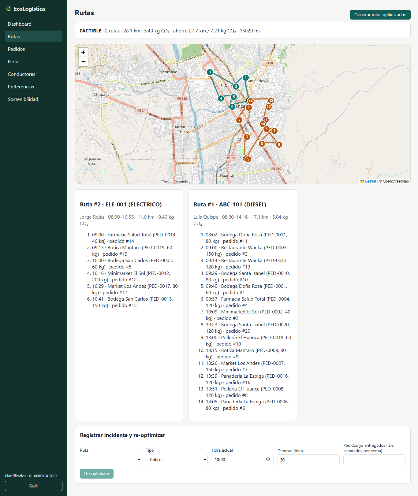

# Anexo C: Pruebas E2E

| Campo | Valor |
|---|---|
| Proyecto | EcoLogística - Optimizador de rutas sostenibles de última milla |
| Organización | DistriRápido S.A.C., Huancayo, Junín |
| Curso | Taller de Proyectos 2, Universidad Continental |
| Versión | 1.0.0 |
| Fecha | 13/11/2026 |
| Elaborado por | Fernando Rodrigo Chaupis Espinoza |
| Revisado por | Docente: Daniel Gamarra Moreno |

---
Pruebas automatizadas con **Playwright** (`e2e/test_e2e.py`) sobre el sistema levantado con los datos demo.

```bash
cd backend && python -m app.seed && uvicorn app.main:app --port 8000
cd frontend && npm run build && node scripts/servidor-estatico.mjs dist 4176
pip install pytest playwright
pytest e2e -v
```

| ID | Escenario | Resultado | Evidencia |
|---|---|:-:|---|
| E2E-01 | El planificador inicia sesión y recorre Dashboard, Pedidos (paginado), Flota, Conductores y Preferencias | Aprobado | [login](evidencias/e2e-01-login.png) · [dashboard](evidencias/e2e-02-dashboard.png) · [pedidos](evidencias/e2e-03-pedidos.png) · [flota](evidencias/e2e-04-flota.png) · [conductores](evidencias/e2e-05-conductores.png) · [preferencias](evidencias/e2e-06-preferencias.png) |
| E2E-02 | Genera rutas, se dibujan en el mapa y se re-optimiza una ruta por tráfico | Aprobado | [rutas](evidencias/e2e-07-rutas-generadas.png) · [re-optimizada](evidencias/e2e-08-ruta-reoptimizada.png) |
| E2E-03 | El administrador ve el reporte de sostenibilidad y el plan de compensación | Aprobado | [sostenibilidad](evidencias/e2e-09-sostenibilidad.png) |
| E2E-04 | El conductor no ve los menús Pedidos, Flota ni Conductores | Aprobado | [vista conductor](evidencias/e2e-10-vista-conductor.png) |

**Resultado: 4 de 4 aprobadas.** En cada pantalla también se ejecuta axe-core (WCAG 2.1 AA): 0 violaciones.


